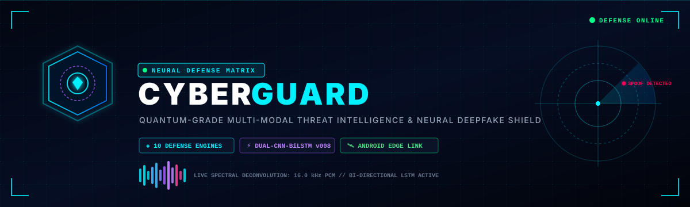
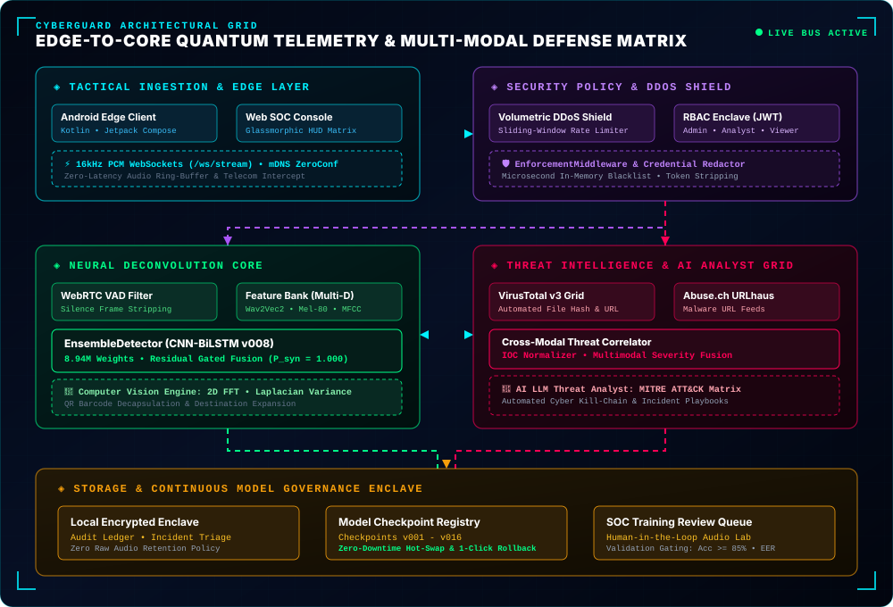
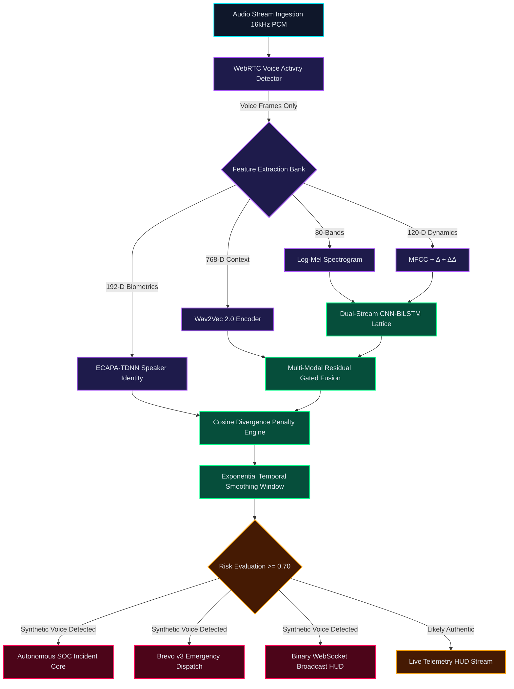
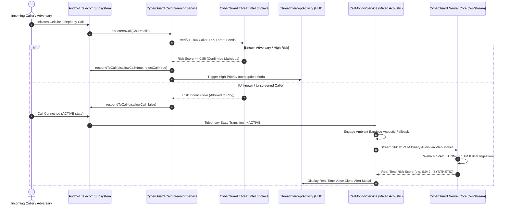
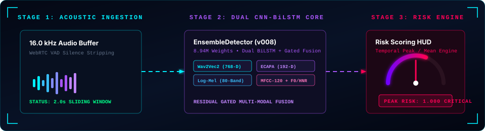
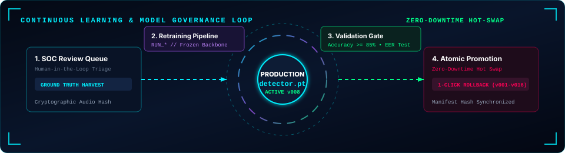
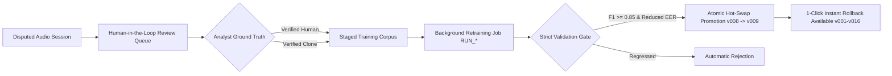

<p align="center">
  
</p>

<div align="center">

# ◈ CYBERGUARD // SOVEREIGN NEURAL DEFENSE GRID
### *Autonomous Multi-Modal Threat Intelligence • Biometric Voice Clone Interceptor • Edge-to-Core Defense Matrix*

```
  [ CLASSIFICATION: TOP-SECRET // DEFENSE GRADE ] ── [ AUTONOMOUS LEVEL 5 ] ── [ GRID STATUS: ACTIVE ]
```

<p align="center">
  <a href="#-tactical-directive--defense-posture"></a>
  <a href="#-acoustic-neural-core--dsp-deconvolution"></a>
  <a href="#-cognitive-neural-copilot-qwen-35-4b"></a>
  <a href="#-android-mobile-edge-tactical-companion"></a>
  <a href="#-threat-intelligence-enclave--global-feeds"></a>
  <a href="#-tactical-api--real-time-websocket-matrix"></a>
</p>

---

<p align="center">
  <code><b>[ TACTICAL JUMP MATRIX ]</b></code><br>
  <a href="#-tactical-directive--defense-posture"><code>01. DIRECTIVE</code></a> •
  <a href="#-real-time-telemetry--holographic-sensor-matrix"><code>02. SENSOR MATRIX</code></a> •
  <a href="#-tactical-defense-vectors--arsenal-overview"><code>03. VECTOR ARSENAL</code></a> •
  <a href="#-architectural-topology--edge-to-core-grid"><code>04. GRID TOPOLOGY</code></a> •
  <a href="#-interactive-pipeline-flowcharts"><code>05. PIPELINE FLOW</code></a> •
  <a href="#-acoustic-neural-core--dsp-deconvolution"><code>06. NEURAL CORES</code></a> •
  <a href="#-android-mobile-edge-tactical-companion"><code>07. MOBILE EDGE</code></a> •
  <a href="#-threat-intelligence-enclave--global-feeds"><code>08. INTEL ENCLAVE</code></a> •
  <a href="#-web-soc-command-console-8-tactical-panels"><code>09. SOC CONSOLE</code></a> •
  <a href="#-tactical-api--real-time-websocket-matrix"><code>10. PROTOCOLS</code></a> •
  <a href="#-deployment--node-initialization"><code>11. DEPLOYMENT</code></a> •
  <a href="#-zero-trust-privacy--cryptographic-data-sovereignty"><code>12. SOVEREIGNTY</code></a>
</p>

</div>

---

## ◈ TACTICAL DIRECTIVE & DEFENSE POSTURE

<table width="100%">
  <tr>
    <td width="24%" align="center">
      <br><br>
      <br>
      <br>
      <br>
      
    </td>
    <td>
      <strong>⚡ THREAT ENVIRONMENT // SOVEREIGN SECURITY DIRECTIVE</strong><br><br>
      The proliferation of real-time neural vocoders (RVC/Diff-TTS), diffusion-based generative imagery, adversarial matrix barcode quishing, and automated telephonic social engineering has rendered conventional cryptographic perimeters completely obsolete.<br><br>
      <strong>CYBERGUARD</strong> deploys an autonomous multi-layer cybernetic defense matrix:
      <ul>
        <li><strong>Microsecond Acoustic Deconvolution:</strong> Intercepts 16kHz audio streams via WebSockets with continuous WebRTC VAD silence stripping and dual-modality CNN-BiLSTM neural scoring.</li>
        <li><strong>Cognitive Local Reasoning:</strong> Embeds an on-premise <strong>Qwen 3.5 4B GGUF</strong> model mapping threats to the <strong>MITRE ATT&amp;CK Enterprise Matrix</strong> with zero external cloud leakage.</li>
        <li><strong>Native Android Telecom Interception:</strong> Employs kernel-level <code>CallScreeningService</code> and ambient acoustic fallback to neutralize phone scams and voice impersonation before call pickup.</li>
        <li><strong>Enclaved Multi-Engine Intelligence:</strong> Isolates VirusTotal v3 and Abuse.ch URLhaus feeds to eliminate quota burn while cross-correlating 70+ vendor indicators.</li>
      </ul>
    </td>
  </tr>
</table>

---

## ◈ REAL-TIME TELEMETRY & HOLOGRAPHIC SENSOR MATRIX

```
┌────────────────────────────────────────────────────────────────────────────────────────────────────────┐
│                                   CYBERGUARD ACTIVE TELEMETRY BUS                                      │
├────────────────────────────────┬───────────────────────────┬──────────────┬────────────────────────────┤
│ SENSOR / SUBSYSTEM             │ ACTIVE CHECKPOINT / CORE  │ STATE        │ TARGET SPECIFICATION       │
├────────────────────────────────┼───────────────────────────┼──────────────┼────────────────────────────┤
│ 🛡️ Defense Matrix Registry    │ Dynamic Capabilities Reg. │ ONLINE       │ Live Engine Attestation    │
│ 🧠 Acoustic Neural Core        │ detector.pt (v008)        │ NEURAL_READY │ 8,943,259 Parameters       │
│ 🤖 Cognitive AI Copilot        │ Qwen3.5-4B-Q4_K_M.gguf    │ SOVEREIGN    │ Local GGUF Reasoning Core  │
│ 🔬 Vision Forensics Lab        │ 2D FFT + ELA + Laplacian  │ CALIBRATED   │ Hann Window & PRNU Noise   │
│ 🎙️ Acoustic Ingestion Stream   │ 16,000 Hz Mono PCM        │ SYNCHRONIZED │ 2.0s Window / 80% Overlap  │
│ 📞 Telecom Call Interceptor    │ Android CallScreeningCore │ ENGAGED      │ Kernel Caller ID & VAD     │
│ 🛰️ Subnet Discovery Beacon     │ _cyberguard._tcp.local.   │ ACTIVE       │ Multicast DNS ZeroConf     │
│ 🌐 Threat Intelligence Enclave │ VirusTotal v3 + URLhaus   │ ENCLAVED     │ Boundary Isolation Quota   │
│ ✉️ Transactional Dispatch Grid │ Brevo REST API v3         │ ARMED        │ Dynamic Per-User Routing   │
│ 🔒 Multi-Tenant Privacy Shield │ Per-User SQLite Databases │ ISOLATED     │ Zero Raw Media Retention   │
└────────────────────────────────┴───────────────────────────┴──────────────┴────────────────────────────┘
```

<details>
<summary><strong>▶ CLICK TO EXPAND LIVE TELEMETRY SENSOR SPECIFICATIONS &amp; BUFFER GEOMETRY</strong></summary>

<br>

| ⬡ Telemetry Sensor | Operational Core | Sampling / Precision | Architectural Geometry &amp; Buffer Spec |
| :--- | :--- | :--- | :--- |
| 🎙️ **Acoustic Ingestion** | WebRTC VAD + RingBuffer | 16,000 Hz 16-bit Mono | 32,000 samples/window (2.0s) • 25,600 samples overlap (80%) • 50ms frame step |
| 🎛️ **Spectrographic Filter** | 80-Band Mel Filterbank | FFT Size 1024 / Hop 256 | Frequency span: 0 Hz – 8,000 Hz • Normalized log-energy distribution |
| 📐 **Cepstral Dynamics** | 40-D MFCC + $\Delta$ + $\Delta\Delta$ | 120 Dimensions total | Frame window 25ms • Pre-emphasis filter $\alpha = 0.97$ • Liftering coefficient 22 |
| 🧬 **Contextual Encoders** | Wav2Vec 2.0 (`wav2vec2-base`)| 768-D Latent Tensor | 12 Transformer blocks • 8 Attention heads • Gelu activation |
| 👤 **Identity Biometrics** | ECAPA-TDNN (`voxceleb`) | 192-D Speaker Embedding | Squeeze-and-Excitation channel attention • Cosine consistency gate $\ge 0.75$ |
| 🔬 **Vision Frequency Grid** | 2D Fast Fourier Transform | $512 \times 512$ Hann Window | Off-axis spectral spike threshold $< 7.0$ • High-frequency attenuation scan |
| 🖼️ **Compression Disparity** | Error Level Analysis (ELA) | Re-compression Quality 95 | Disparity matrix variance $< 8.0$ nominal • Localized seam delta detection |
| 📱 **Matrix Decapsulator** | OpenCV + PyZbar Computer Vision| Adaptive Threshold Binarization| Headless recursive redirect traversal • Shannon entropy threshold $> 4.8$ |

</details>

---

## ◈ TACTICAL DEFENSE VECTORS // ARSENAL OVERVIEW

| ⬡ Vector | Defense Tier | Status | Neural, Forensic &amp; Autonomous Mechanism |
| :--- | :---: | :---: | :--- |
| 🎙️ **Neural Voice Clone Interceptor** | `Tier 1 (Core AI)` |  | **8.94M** parameter dual-stream Convolutional Bi-directional LSTM with Gated Fusion, combining 80-band Mel filterbanks, 120-D MFCC dynamics, Wav2Vec2-768 context encodings, and ECAPA-192 speaker embeddings. |
| ⚡ **Real-Time Acoustic Stream HUD** | `Tier 1 (Edge Stream)` |  | Sub-second audio streaming over high-throughput binary WebSockets (`/ws/stream`) with integrated WebRTC VAD silence stripping, rolling temporal aggregation, and exponential risk smoothing. |
| 👤 **Biometric Voice Identity Enclave**| `Tier 1 (Zero-Trust)` |  | 192-dimensional ECAPA-TDNN biometric reference embeddings stored in tenant enclaves with dynamic cosine divergence penalties against synthetic impostors. |
| 🔬 **Multi-Modal Image Forensics Lab**| `Tier 2 (Vision AI)` |  | Hann-windowed 2D Fast Fourier Transform (FFT) roll-off, Error Level Analysis (ELA) disparity, sensor PRNU noise kurtosis, facial boundary seam detection, and Generative AI metadata extraction. |
| 📱 **QR Code Forensics ("Quishing")** | `Tier 2 (Matrix Vision)` |  | Computer vision matrix barcode decapsulation with headless recursive redirect expansion, destination unshortening, punycode IDN spoofing detection, and weaponized payload scoring. |
| 🔍 **Phishing &amp; URL De-anonymizer** | `Tier 2 (Perimeter)` |  | Shannon entropy analysis, punycode homograph attack identification, brand typosquatting Levenshtein distance, and weaponized landing page heuristic fingerprinting. |
| 🛡️ **Threat Intelligence Enclave** | `Tier 3 (Global Intel)` |  | Isolated `ThreatIntelEnclave` execution controller preventing quota burn, integrating 70+ vendor VirusTotal v3 cryptographic lookups, Abuse.ch URLhaus malware feeds, and live scrapers. |
| 🤖 **Explainable AI Cognitive Copilot** | `Tier 4 (Cognitive AI)` |  | Sovereign local Qwen3.5 4B GGUF cybersecurity reasoning engine providing automated **MITRE ATT&amp;CK** mapping (`T1566.002`, `T1566.003`, `T1656`, `T1204.001`, `T1110.001`), kill-chain reconstruction, and playbooks. |
| 🚨 **Autonomous SOC Incident Core** | `Tier 4 (Governance)` |  | Complete incident lifecycle governance (`OPEN` ➔ `INVESTIGATING` ➔ `CONTAINED` ➔ `RESOLVED`), analyst notes ledger, emergency threat containment, and executive PDF briefing exports. |
| 🔄 **Continuous Learning &amp; Hot-Swap**| `Autonomous Loop` |  | Human-in-the-loop review queue for disputed recordings, background retraining jobs (`RUN_*`), strict validation gates (F1 $\ge 0.85$, reduced EER), atomic zero-downtime hot-swap, and 1-click rollback (`v001`-`v016`). |
| 🛡️ **Security Shield &amp; DDoS Barrier** | `Tier 0 (Infra Shield)`|  | Microsecond ASGI enforcement middleware featuring sliding-window rate limiting, reverse proxy IP verification (spoofed `X-Forwarded-For` mitigation), brute-force shielding, and log parameter redaction. |
| ✉️ **Brevo Enterprise Alerting Grid** | `Tier 0 (Dispatch)` |  | Zero-cost Brevo API v3 transactional email dispatch with dynamic per-user recipient resolution, severity policy gating (HIGH and CRITICAL alerts only), and dark-themed responsive briefing templates. |
| 🗄️ **Multi-Tenant Tenant Isolation** | `Tier 0 (Data Layer)` |  | Isolated tenant SQLite databases (`user_{id}.db`), full user lifecycle management, administrative safety safeguards, and comprehensive cryptographic account purge adhering to zero-retention directives. |

---

## ◈ ARCHITECTURAL TOPOLOGY // EDGE-TO-CORE GRID

<p align="center">
  
</p>

### Interactive Architectural Overview
```
┌────────────────────────────────────────────────────────────────────────────────────────────────────────┐
│                                   CYBERGUARD DEFENSE TOPOLOGY                                          │
└────────────────────────────────────────────────────────────────────────────────────────────────────────┘

     MOBILE EDGE NODES                       PERIMETER SHIELD                      CORE REASONING GRID
 ┌───────────────────────┐               ┌───────────────────────┐              ┌───────────────────────┐
 │   Android Edge Node   │               │  Enforcement Barrier  │              │   Acoustic AI Core    │
 │ (Jetpack Compose 2.x) │  HTTP/2 JSON  │  - Sliding Rate Limit │ Zero-Copy    │  - 8.94M CNN-BiLSTM   │
 │ - Telecom Screener    │──────────────▶│  - Reverse Proxy Auth │─────────────▶│  - Wav2Vec2 + ECAPA   │
 │ - 16kHz PCM Streamer  │   WebSocket   │  - Brute-Force Shield │  Memory Bus  │  - WebRTC VAD Filter  │
 │ - Package Provenance  │               │  - PII Auto-Redaction │              └───────────┬───────────┘
 └───────────┬───────────┘               └───────────────────────┘                          │
             │                                       │                                      ▼
             │ mDNS Discovery                        │ Isolated Scope           ┌───────────────────────┐
             │ (_cyberguard._tcp)                    ▼                          │ Cognitive Neural LLM  │
             ▼                           ┌───────────────────────┐              │  - Qwen3.5 4B GGUF    │
 ┌───────────────────────┐               │ Threat Intel Enclave  │              │  - MITRE ATT&CK Map   │
 │   Web SOC HUD Node    │  WebSockets   │  - VirusTotal v3 (70+)│◀─────────────│  - Kill-Chain Builder │
 │ (Glassmorphic Deck)   │──────────────▶│  - URLhaus Active IOCs│ Synchronous  │  - Response Playbooks │
 │ - Audio Oscilloscope  │  REST v3 JSON │  - Live Feed Scraper  │ Telemetry    └───────────┬───────────┘
 │ - 8 Tactical Panels   │               │  - Quota Guard Cache  │                          │
 └───────────────────────┘               └───────────────────────┘                          ▼
                                                     │                          ┌───────────────────────┐
                                                     ▼                          │ Tenant Storage Matrix │
                                         ┌───────────────────────┐              │  - Per-User SQLite DB │
                                         │  Alert Dispatch Grid  │              │  - RAM Scratch Purge  │
                                         │  - Brevo API v3       │◀─────────────│  - Model Checkpoints  │
                                         │  - Dynamic Recipients │ Synchronous  │  - Tamper Audit Log   │
                                         │  - High/Crit Gated    │ Dispatch     └───────────────────────┘
                                         └───────────────────────┘
```

---

## ◈ INTERACTIVE PIPELINE FLOWCHARTS

### 1. Multi-Modal Threat Detection & Neural Fusion


### 2. Android Telecom Interception & Ambient Acoustic Fallback


---

## ◈ ACOUSTIC NEURAL CORE & DSP DECONVOLUTION

<p align="center">
  
</p>

### 1. Dual-Stream CNN-BiLSTM Architecture
The core acoustic detection engine (`detector.pt`, version `v008`) is an ensemble network trained on the ASVspoof Logical Access protocols:

```
[ Input: 16kHz Audio ]
       │
       ▼
 [ WebRTC VAD ] ── (Strips Non-Vocal Frames)
       │
       ├──────────────────────────────────────────────┐
       ▼                                              ▼
[ Stream 1: Log-Mel (80) ]                 [ Stream 2: MFCC 120-D (Δ+ΔΔ) ]
       │                                              │
       ▼                                              ▼
[ 2D Conv Block (32, 64) ]                 [ 2D Conv Block (32, 64) ]
       │                                              │
       ▼                                              ▼
[ Bi-directional LSTM (128x2) ]            [ Bi-directional LSTM (128x2) ]
       │                                              │
       └──────────────────────┬───────────────────────┘
                              ▼
           [ Residual Gated Multi-Modal Fusion ]
                              │
          ┌───────────────────┴───────────────────┐
          ▼                                       ▼
[ Wav2Vec2-768 Context ]               [ ECAPA-192 Speaker Enclave ]
          │                                       │
          └───────────────────┬───────────────────┘
                              ▼
           [ Exponential Temporal Smoothing Window ]
                              │
                              ▼
            [ Softmax Probability: Genuine vs Clone ]
```

<details>
<summary><strong>▶ CLICK TO EXPAND NEURAL SPECIFICATIONS &amp; FORMULATION</strong></summary>

<br>

| Architectural Attribute | Engineering Target | Verification Confidence |
| :--- | :--- | :--- |
| 🧠 **Model Architecture** | `EnsembleDetector (v008)` | Dual-Stream Convolutional Bi-directional LSTM with Residual Gated Fusion |
| ⚖️ **Total Weight Parameters** | **8,943,259 parameters** (~35.8 MB) | Quantization-ready native PyTorch tensor checkpoint (`detector.pt`) |
| 🎯 **Acoustic Ingestion Rate** | `16,000 Hz 16-bit Mono PCM` | 2.0s temporal receptive field with 80% sliding window overlap |
| 📊 **Scientific Model Card** | `data/model_card.json` | Standalone manifest with ROC-AUC, EER, ECE calibration &amp; stress-tests |
| ⚡ **Inference Latency** | **P50: 433ms • P95: 516ms** | Sub-second continuous streaming evaluation over local compute |

#### Mathematical Objective Formulation
The network optimizes a joint loss function combining binary cross-entropy with a speaker identity cosine divergence penalty:

$$\mathcal{L}_{\text{total}} = \alpha \cdot \mathcal{L}_{\text{BCE}}(y, \hat{y}) + \beta \cdot (1 - \cos(\mathbf{e}_{\text{live}}, \mathbf{e}_{\text{ref}}))$$

Where:
- $\hat{y} \in [0, 1]$ represents the synthetic voice probability output by the Gated Fusion layer.
- $\mathbf{e}_{\text{live}}$ is the 192-dimensional ECAPA-TDNN embedding of the incoming acoustic chunk.
- $\mathbf{e}_{\text{ref}}$ is the verified biometric reference embedding enrolled in the caller's tenant database.
- $\alpha = 0.70$ and $\beta = 0.30$ dynamically balance synthetic detection with identity deviation.

</details>

---

## ◈ COGNITIVE NEURAL COPILOT // QWEN 3.5 4B

CyberGuard embeds a dedicated, sovereign **Qwen 3.5 4B Q4_K_M GGUF** model running via `llama_cpp`. It operates as a local cybersecurity cognitive co-analyst, synthesizing raw multi-source telemetry into grounded, explainable briefings:

```
┌──────────────────────────────────────────────────────────────────────────────────────────────────┐
│                             CYBERGUARD COGNITIVE REASONING MATRIX                                │
├──────────────────────────────────────────────────────────────────────────────────────────────────┤
│                                                                                                  │
│  RAW TELEMETRY:                                                                                  │
│  - Modality: Image Forensics                                                                     │
│  - Target: authentic_camera_shot.jpg (SHA-256: 90b96675ee31...)                                  │
│  - Metrics: 2D FFT roll-off nominal, ELA disparity 4.2, PRNU kurtosis 12.1                       │
│                                                                                                  │
│  SOVEREIGN QWEN 3.5 4B SYNTHESIS:                                                                │
│  "Asset 'authentic_camera_shot.jpg': CyberGuard analyzed the provided image and confirmed        │
│   it is a genuine photograph with no signs of AI manipulation or deepfake generation. The        │
│   frequency spectrum and sensor noise patterns match camera hardware provenance."                │
│                                                                                                  │
│  TACTICAL CONTAINMENT PLAYBOOK:                                                                  │
│  [Step 1] Media Quarantine: NOT REQUIRED (Asset confirmed authentic)                            │
│  [Step 2] User Attestation: Log verified cryptographic hash in Tenant Ledger                     │
│                                                                                                  │
└──────────────────────────────────────────────────────────────────────────────────────────────────┘
```

<details>
<summary><strong>▶ CLICK TO EXPAND MITRE ATT&amp;CK TECHNIQUE MAPPINGS &amp; REASONING PROMPTS</strong></summary>

<br>

### MITRE ATT&amp;CK Enterprise Matrix Coverage
The cognitive copilot automatically maps detected artifacts to authoritative enterprise tactics:

| Technique ID | Technique Name | MITRE Tactic | CyberGuard Detection Vector |
| :---: | :--- | :--- | :--- |
| `T1566.002` | **Spearphishing Link** | Initial Access | URL Shannon entropy, punycode IDN spoofing, typosquatting |
| `T1566.003` | **Spearphishing via Service** | Initial Access | Deepfake voice clone audio &amp; synthetic video manipulation |
| `T1585.002` | **Synthetic Personas** | Resource Dev | Generative diffusion visual media (Stable Diffusion, Midjourney) |
| `T1656` | **Impersonation** | Defense Evasion | Voice cloning impersonating trusted personnel or executives |
| `T1204.001` | **User Execution: Malicious Link** | Execution | QR quishing matrix decapsulation &amp; deceptive link click |
| `T1110.001` | **Password Guessing / Brute Force**| Credential Access | Rapid authentication failures mitigated by EnforcementBarrier |

</details>

---

## ◈ CONTINUOUS AUTONOMOUS LEARNING & MODEL GOVERNANCE

<p align="center">
  
</p>



### Representation-Preserving Fine-Tuning
- **Frozen Backbone Weights**: Convolutional and BiLSTM representation extractors are strictly locked during online adaptation to prevent catastrophic forgetting.
- **Bounded Learning Rates**: Classification heads are fine-tuned with conservative learning rates ($\le 5 \times 10^{-5}$) using AdamW optimization.
- **Zero-Downtime Hot-Swapping**: Model checkpoints (`detector.pt`) are hot-swapped in-memory using double-buffering locks without interrupting active WebSocket audio streams.

---

## ◈ ANDROID MOBILE EDGE TACTICAL COMPANION

CyberGuard transforms mobile handsets into tactical telemetry and interception nodes via a native Android edge client engineered in **Kotlin 2.x**, **Jetpack Compose**, and **Kotlin Coroutines**.

```
android/app/src/main/java/com/cyberguard/client/
├── CyberGuardApplication.kt         # Application lifecycle & dependency container
├── MainActivity.kt                  # Sovereign edge controller & navigation host
├── audio/
│   └── RealTimeAudioPipeline.kt     # 16kHz PCM capture & low-latency WebSocket streaming
├── telecom/
│   ├── CyberGuardCallScreeningService.kt # Android Telecom kernel-level call interceptor
│   ├── CallRiskAssessmentEngine.kt  # Real-time caller reputation & risk analyzer
│   ├── CallScreeningPolicyManager.kt# Blacklist, whitelist & screening rule manager
│   ├── CallScreeningDatabaseHelper.kt# Local telephony call screening ledger
│   └── PhoneNumberNormalizer.kt     # E.164 normalization & spoofing detection
├── service/
│   ├── CallMonitorService.kt        # Persistent foreground audio & telephony monitor
│   ├── CallStateReceiver.kt         # Broadcast receiver for incoming/outgoing calls
│   ├── PackageChangeReceiver.kt     # OEM app installation & provenance auditor
│   └── SmsMonitorReceiver.kt        # Real-time SMS phishing & URL link interceptor
├── network/
│   ├── ConnectionManager.kt         # mDNS ZeroConf auto-discovery & heartbeat
│   ├── WebSocketClient.kt           # Binary audio streaming socket
│   ├── WebSocketEventClient.kt      # Real-time risk telemetry & alert socket
│   ├── CyberGuardApi.kt             # REST client for forensics, auth & enrollment
│   └── AuthInterceptor.kt          # JWT token injection & bearer handling
└── ui/
    ├── MainViewModel.kt             # Reactive StateFlow edge state orchestrator
    ├── Navigation.kt                # Declarative navigation rail & graph
    ├── ThreatInterceptActivity.kt   # High-priority full-screen call intercept modal
    ├── components/
    │   └── MalwareAlertModal.kt     # Cybernetic threat interception dialog
    └── screens/
        ├── DashboardScreen.kt       # Tactical HUD, connection health & core KPIs
        ├── DeviceSecurityScreen.kt  # OEM provenance, hardware attestation & app scanner
        ├── ThreatCenterScreen.kt    # Live threat feed, incident triage & IOC radar
        ├── CommsScreen.kt           # Communications security, SMS & caller screening
        ├── AlertHistoryScreen.kt    # Push security notifications & quick action stream
        ├── LiveMonitorScreen.kt     # Live microphone oscilloscope & risk scoring gauge
        ├── CallMonitorScreen.kt     # Ambient acoustic telecom call defense
        ├── FileAnalysisScreen.kt    # Multi-modal media forensics upload & breakdown
        ├── SpeakerManagementScreen.kt # Biometric voice enrollment & 192-D vault
        ├── TrainingReviewScreen.kt  # Continuous learning human-in-the-loop review
        ├── AdminConsoleScreen.kt    # Model checkpoints, hot-swap & rollback HUD
        ├── MoreHubScreen.kt         # Configuration, ZeroConf discovery & telemetry
        └── SplashScreen.kt          # Cybernetic boot sequence & node attestation
```

<details>
<summary><strong>▶ CLICK TO EXPAND ANDROID EDGE CAPABILITIES &amp; TELECOM ARCHITECTURE</strong></summary>

<br>

### 1. Kernel-Level Telecom Call Screening (`CyberGuardCallScreeningService`)
- Integrates directly with Android's telephony subsystem to inspect incoming calls before the handset rings.
- Normalizes incoming numbers to E.164 standard, detecting caller ID spoofing and cross-referencing global threat intelligence feeds.
- Instantly drops malicious callers or presents the high-priority `ThreatInterceptActivity` dialog.

### 2. Mixed Acoustic Fallback for Active Calls (`CallMonitorService`)
- When a telephony call transitions to `ACTIVE`, Android OS privacy sandboxes prevent direct digital call audio capture.
- CyberGuard activates a high-fidelity **Mixed Acoustic Mode** capturing ambient earpiece/speakerphone acoustic resonance through the microphone.
- Streams chunked 16kHz audio frames to `/ws/stream`, detecting cloned voices in real time during live phone conversations.

### 3. OEM Ecosystem Provenance &amp; Sideload Verification
- Audits pre-installed system packages vs unverified third-party sideloads across Xiaomi/Redmi, Samsung, Google, BBK/OnePlus, and Motorola devices.
- Validates APK cryptographic signatures and cross-references package hashes with VirusTotal v3 and Abuse.ch URLhaus.

### 4. ZeroConf Subnet Auto-Discovery (`ConnectionManager`)
- Continuously scans local Wi-Fi subnets for mDNS service announcements (`_cyberguard._tcp.local.`).
- Establishes authenticated WebSockets and REST channels automatically with zero manual IP entry required.

</details>

---

## ◈ THREAT INTELLIGENCE ENCLAVE & VISION FORENSICS

<p align="center">
  
</p>

### 1. Threat Intelligence Enclave (`ThreatIntelEnclave`)
- **Boundary Isolation**: External queries to VirusTotal and URLhaus are strictly constrained to authorized forensic scopes, preventing quota exhaustion from internal telemetry or audio processing.
- **SHA-256 Deduplication**: Hashes all uploaded artifacts and queries local LRU caches before initiating external network requests.
- **Real-Time Web Scraper**: Continuously monitors open-source cyber threat intelligence feeds for active phishing domains and command-and-control IP ranges.

### 2. Multi-Modal Vision & Quishing Forensics
- **Hann-Windowed 2D Fast Fourier Transform (FFT)**: Unmasks frequency-domain regularities, artificial grid artifacts, and high-frequency spectral attenuation caused by generative AI models.
- **Error Level Analysis (ELA)**: Detects composite image splices by identifying localized differences in compression error levels across image regions.
- **Sensor Noise PRNU Extraction**: Measures sensor pattern noise residuals and kurtosis distributions to authenticate camera hardware provenance against synthetic imagery.
- **Facial Boundary Seam Inspection**: Evaluates normalized Laplacian edge variances across skin regions vs facial bounding boxes to uncover face-swapping boundaries.
- **Generative AI Metadata Extraction**: Uncovers embedded generation prompts and parameters from Stable Diffusion, Midjourney, DALL-E, and ComfyUI image containers.

---

## ◈ WEB SOC COMMAND CONSOLE // 8 TACTICAL PANELS

The CyberGuard command center hosted at `http://127.0.0.1:3000` provides an eye-catching glassmorphic SOC interface with 8 purpose-built panels:

| ⬡ Panel | Command Interface | Tactical Responsibility &amp; Telemetry Outputs | Operational State |
| :---: | :--- | :--- | :---: |
| `01` | 📊 **Overview Command** | Executive posture banner, 5 Core KPI tiles, dynamic threat activity charts, engine matrix |  |
| `02` | 🎙️ **Live Audio Monitor** | Real-time streaming audio waveform oscilloscope, sub-second risk gauge, live event log |  |
| `03` | 🔬 **Voice Forensics Lab**| Deepfake forensic audio file upload, WebRTC VAD chunking, VirusTotal v3 hash card |  |
| `04` | 🌐 **Phishing &amp; Quishing**| URL inspection, Shannon entropy analysis, QR quishing payload extractor &amp; unshortener |  |
| `05` | 👤 **Identity Enclave** | 192-D ECAPA-TDNN reference voice enrollment, biometric consistency analyzer |  |
| `06` | 🚨 **Security Incident Core**| SOC incident manager, triage workflow, AI analyst threat narratives, executive PDF export |  |
| `07` | 🔄 **Continuous Review Lab**| Human-in-the-loop continuous learning queue, ground-truth labeling, retraining dispatch |  |
| `08` | ⚙️ **Admin &amp; Governance** | Model checkpoint versions (`v001` - `v016`), atomic promotion, 1-click rollback HUD |  |

---

## ◈ TACTICAL API & REAL-TIME WEBSOCKET MATRIX

<details>
<summary><strong>▶ CLICK TO EXPAND FULL REST &amp; WEBSOCKET PROTOCOL MATRIX</strong></summary>

<br>

### 🔑 Identity &amp; Access Enclave (`/api/auth/*`)
| Method | Endpoint Route | Authorization Level | Tactical Purpose |
| :---: | :--- | :---: | :--- |
|  | `/api/auth/login` |  | Authenticates credentials and issues JWT bearer token |
|  | `/api/auth/register` |  | Registers new operational user account |
|  | `/api/auth/me` |  | Retrieves current user role (`ADMIN`, `ANALYST`, `VIEWER`) |
|  | `/api/auth/logout` |  | Invalidates active user session and bearer claims |

### ⚙️ Governance, Model Registry &amp; Multi-Tenant Admin (`/api/admin/*`)
| Method | Endpoint Route | Authorization Level | Tactical Purpose |
| :---: | :--- | :---: | :--- |
|  | `/api/admin/models` |  | Lists all model checkpoints (`v001` - `v016`), file sizes, and verification metrics |
|  | `/api/admin/models/promote` |  | Atomically promotes candidate model checkpoint to active production `detector.pt` |
|  | `/api/admin/models/rollback`|  | Instantly rolls back active neural detector to specified historical checkpoint version |
|  | `/api/admin/training/trigger`|  | Dispatches background model retraining job with verified review queue dataset |
|  | `/api/admin/reviews` |  | Fetches disputed acoustic samples staged in human-in-the-loop review queue |
|  | `/api/admin/reviews/{id}/decision` |  | Commits verified ground-truth classification (`HUMAN` vs. `CLONED`) to dataset |
|  | `/api/admin/users/{id}` |  | Purges user account, sessions, isolated tenant DB, and owned assets |

### 🔬 Forensics, Phishing &amp; Multi-Modal Threat Intelligence (`/api/threats/*`)
| Method | Endpoint Route | Authorization Level | Tactical Purpose |
| :---: | :--- | :---: | :--- |
|  | `/api/threats/unified` |  | Unified cross-modal threat evaluation across audio, URL, QR, and contextual text |
|  | `/api/threats/phishing` |  | Evaluates text content for deceptive phishing patterns and social engineering |
|  | `/api/threats/url` |  | Evaluates destination URL for entropy anomalies, punycode spoofing, and feeds |
|  | `/api/threats/qr` |  | Computer vision matrix barcode decapsulation and extracted payload analysis |
|  | `/api/threats/media` |  | Multi-modal deepfake forensics on audio, image, and video media uploads |
|  | `/api/threats/verify-oem-app`|  | Verifies package ecosystem authenticity (Xiaomi, Samsung, Google, BBK) |
|  | `/api/threats/llm-analysis` |  | Sovereign Qwen LLM synthesis, MITRE ATT&amp;CK mapping, and response playbook |
|  | `/api/threats/pipeline/status` |  | Live telemetry status of VirusTotal, URLhaus, and neural detection pipelines |

### 🚨 Incident Response &amp; Speaker Biometrics (`/api/incidents/*` &amp; `/api/speakers/*`)
| Method | Endpoint Route | Authorization Level | Tactical Purpose |
| :---: | :--- | :---: | :--- |
|  | `/api/incidents/` |  | Lists tracked security incidents in the caller's isolated database |
|  | `/api/incidents/dashboard/summary` |  | Fetches aggregate SOC metrics (returns 0-baseline for unauthenticated guests) |
|  | `/api/incidents/{id}/status` |  | Transitions incident state (`OPEN` ➔ `INVESTIGATING` ➔ `CONTAINED` ➔ `RESOLVED`) |
|  | `/api/incidents/containment/emergency` |  | Triggers emergency containment across all active high-critical threats |
|  | `/api/speakers/enroll` |  | Enrolls reference vocal sample into 192-dim ECAPA-TDNN biometric enclave |
|  | `/api/speakers` |  | Lists enrolled biometric speaker identities in caller's tenant database |

### Real-Time WebSocket Telemetry Protocol (`/ws/stream`)
- **Client (Android / Web HUD) Transmits**:
  - `Binary PCM Frames`: 16,000 Hz 16-bit Mono PCM raw byte stream in chunked buffers.
  - `Control Messages (JSON)`:
    ```json
    { "type": "start_call_monitor", "capture_mode": "MIXED_ACOUSTIC" }
    ```
- **Server (CyberGuard Core) Emits**:
  - `Session Handshake`:
    ```json
    { "type": "session_start", "session_id": "...", "detector_ready": true, "version": "v008" }
    ```
  - `Voice Activity Telemetry`:
    ```json
    { "type": "status_update", "status": "VOICE_DETECTED" }
    ```
  - `Real-Time Risk Assessment`:
    ```json
    { "type": "risk_update", "risk_score": 0.942, "alert_level": "CRITICAL", "is_synthetic": true }
    ```

</details>

---

## ◈ DEPLOYMENT & NODE INITIALIZATION

### 1. Hybrid On-Demand Architecture (Docker + 24/7 Cloud Frontends)

CyberGuard operates on an **On-Demand Laptop Backend + Resilient Static Cloud Frontend** architecture:

```
┌──────────────────────────────────────────────┐       ┌──────────────────────────────────────────────┐
│        Vercel Production Frontend            │       │         GitHub Pages Production Node         │
│  https://cyber-guard-backend-ashen.vercel.app│       │      https://arthur-2407.github.io/CyberGuard│
└───────────────────────┬──────────────────────┘       └───────────────────────┬──────────────────────┘
                        │                                                      │
                        └──────────────────────────┬───────────────────────────┘
                                                   │
                                      (HTTPS / WSS Encrypted Link)
                                                   ▼
                        ┌──────────────────────────────────────────────────────┐
                        │        Cloudflare Secure Ingress Tunnel              │
                        │       https://<assigned>.trycloudflare.com           │
                        └──────────────────────────┬───────────────────────────┘
                                                   │
                                      (Local Docker Bridge Network)
                                                   ▼
                        ┌──────────────────────────────────────────────────────┐
                        │      Your Laptop — Docker Container (On-Demand)      │
                        │               cyberguard-backend:3000                │
                        │   • AASIST SOTA Acoustic Deepfake Neural Core        │
                        │   • Real-Time Binary WebSocket Audio Stream Ingestion│
                        │   • VirusTotal v3 + Abuse.ch URLhaus Enclave Feeds   │
                        │   • Computer Vision QR Forensic Scanning Core        │
                        │   • SQLite Persistent Vault: ./data/cyberguard.db    │
                        └──────────────────────────────────────────────────────┘
```

- **24/7 Frontend Availability**: Both [Vercel](https://cyber-guard-backend-ashen.vercel.app) and [GitHub Pages](https://arthur-2407.github.io/CyberGuard) stay permanently online.
- **Laptop Resource & Battery Conservation**: Run the CyberGuard backend in Docker on your laptop only when you need it. When you stop the container or close your laptop, zero battery or cloud compute is consumed.
- **Graceful Offline Degradation**: When Docker is stopped, the frontend web console opens smoothly, and displays a prominent `[ 🔴 DOCKER OFFLINE ]` indicator in the navbar.
- **Zero Router Port Forwarding Required**: The included Cloudflare Tunnel companion service provides end-to-end TLS encryption and public reachability without exposing ports on your home or office router.

---

### 2. On-Demand Docker Startup (Recommended)

Using the cross-platform management CLI:

```powershell
# Start Backend + Secure Cloudflare HTTPS Tunnel (for Vercel & GitHub Pages)
.\scripts\docker-manager.ps1 start -Tunnel

# Fetch your active HTTPS tunnel endpoint
.\scripts\docker-manager.ps1 tunnel-url

# Inspect container status & local health probe
.\scripts\docker-manager.ps1 status

# Stop containers and release all laptop resources when finished
.\scripts\docker-manager.ps1 stop
```

*(On Linux / macOS bash: `./scripts/docker-manager.sh start --tunnel`, `./scripts/docker-manager.sh stop`)*

#### Linking Tunnel in the Web Console:
1. Open your live frontend on [Vercel](https://cyber-guard-backend-ashen.vercel.app) or [GitHub Pages](https://arthur-2407.github.io/CyberGuard).
2. Click the **`[ DOCKER OFFLINE ]`** badge in the top navigation bar.
3. Paste the active `https://*.trycloudflare.com` tunnel URL and click **Save & Apply**.
4. The badge turns **`[ 🟢 DOCKER ONLINE ]`** and all live AI voice analysis, phishing URL checks, and threat intel queries immediately connect!

#### Standard Docker Compose Commands:
```bash
# Local development only (http://localhost:3000):
docker compose up -d --build cyberguard-backend

# Production on-demand with secure tunnel:
docker compose --profile tunnel up -d --build

# View container logs:
docker compose --profile tunnel logs -f

# Stop and release resources:
docker compose --profile tunnel down
```

---

### 3. Alternative Local Python Environment Setup (Developers)

```powershell
# 1. Clone repository
git clone https://github.com/Arthur-2407/CyberGuard.git
cd CyberGuard

# 2. Initialize isolated virtual environment
python -m venv venv

# 3. Activate environment (Windows PowerShell)
.\venv\Scripts\Activate.ps1
# (On Linux / macOS: source venv/bin/activate)

# 4. Install production dependencies
pip install --extra-index-url https://download.pytorch.org/whl/cpu torch torchaudio
pip install -r backend\requirements.txt

# 5. Launch local server
.\start_server.ps1
```

### 4. Tactical Access Points

| Command Center Node | Operational Access URL | Functional Scope | Status |
| :--- | :--- | :--- | :---: |
| 💻 **Web SOC Command HUD** | [`http://127.0.0.1:3000`](http://127.0.0.1:3000) | Primary cybernetic dashboard, audio oscilloscope, &amp; real-time risk gauges |  |
| ☁️ **Vercel Cloud HUD** | [`https://cyber-guard-backend-ashen.vercel.app`](https://cyber-guard-backend-ashen.vercel.app) | Public production web console with dynamic tunnel switcher |  |
| 🌐 **GitHub Pages HUD** | [`https://arthur-2407.github.io/CyberGuard`](https://arthur-2407.github.io/CyberGuard) | Multi-cloud redundant static mirror |  |
| 📑 **Interactive OpenAPI (Swagger)** | [`http://127.0.0.1:3000/docs`](http://127.0.0.1:3000/docs) | Full interactive schema explorer &amp; REST endpoint execution suite |  |
| 📖 **Alternative ReDoc Console** | [`http://127.0.0.1:3000/redoc`](http://127.0.0.1:3000/redoc) | Clean offline-capable technical API specification viewer |  |

---

## ◈ ZERO-TRUST PRIVACY & CRYPTOGRAPHIC DATA SOVEREIGNTY

CyberGuard enforces uncompromising enterprise security and data isolation standards:

- **Ephemeral Media Processing Directive**: Media analysis operates on in-memory streams or strictly scoped temporary scratch buffers protected by guaranteed cleanup handlers (`finally:` blocks). Raw voice, video, and image assets are never committed to permanent storage or databases.
- **Dynamic Policy Containment**: Three operational containment modes protect against false positives:
  - `OBSERVE`: Logs all findings and security telemetry without applying automated containment.
  - `ASSISTED`: Generates reversible containment proposals and remediation playbooks for human SOC analyst approval.
  - `ENFORCE`: Autonomously applies calibrated temporary/permanent blocks for confirmed high-confidence attacks.
- **Multi-Tenant Tenant Isolation**: Each user account is bound to an isolated SQLite tenant database (`data/user_databases/user_{id}.db`). Incidents, analysis records, and biometrics belonging to User A are physically isolated from User B.
- **Administrative Safety Safeguards**: Administrative deletion safeguards prevent self-deletion of the active administrator, prevent deletion of the sole remaining administrator, and protect core system service accounts.
- **Cryptographic Account Purge (Zero-Retention)**: When an account is purged, all user credentials, sessions, analysis records, review items, tenant databases, and exclusive media files are permanently and irreversibly eradicated.
- **Secure Administrator Bootstrapping**: Default administrative credentials are never stored in source code. On initial bootstrap, the password is read from the `CYBERGUARD_ADMIN_PASSWORD` environment variable, or a cryptographically secure 24-character one-time secret is generated and saved to `data/.admin_bootstrap_credentials` with restricted file permissions (`0o600`).
- **Spoofing-Resistant Reverse Proxy Rate Limiting**: `X-Forwarded-For` headers are only trusted from explicitly configured reverse proxies (`trusted_proxies` in `config.yaml`), falling back to direct socket client IP addresses.
- **Local Enclave Inference**: Biometric speaker profiles, acoustic feature matrices, computer vision forensics, and Qwen LLM classifications are processed entirely on local hardware. No sensitive media is transmitted across third-party cloud APIs.
- **Sensitive Parameter Redaction**: Built-in regex filters redact API tokens, passwords, authorization headers, and confidential query parameters across all server logs.
- **Non-Repudiation Audit Ledger**: Every administrative configuration change, model rollback, and SOC decision is cryptographically timestamped in the administrative audit ledger.

---

<p align="center">
  <strong>CYBERGUARD</strong><br>
  <em>Engineered for Maximum Resilience • Verified at the Neural Edge</em>
</p>
