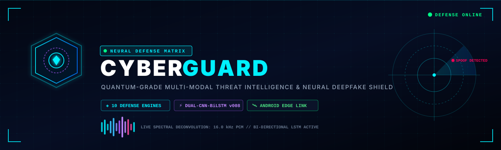
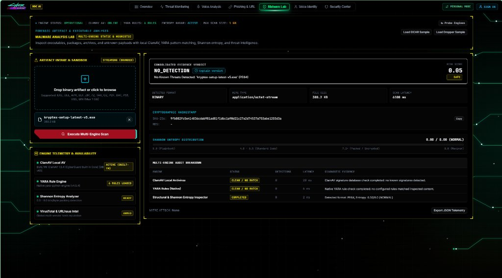
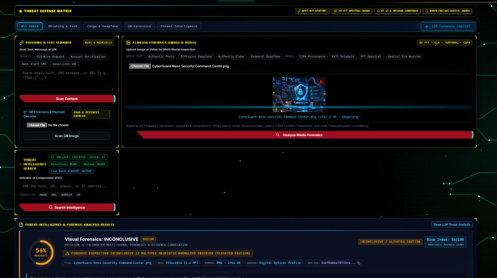
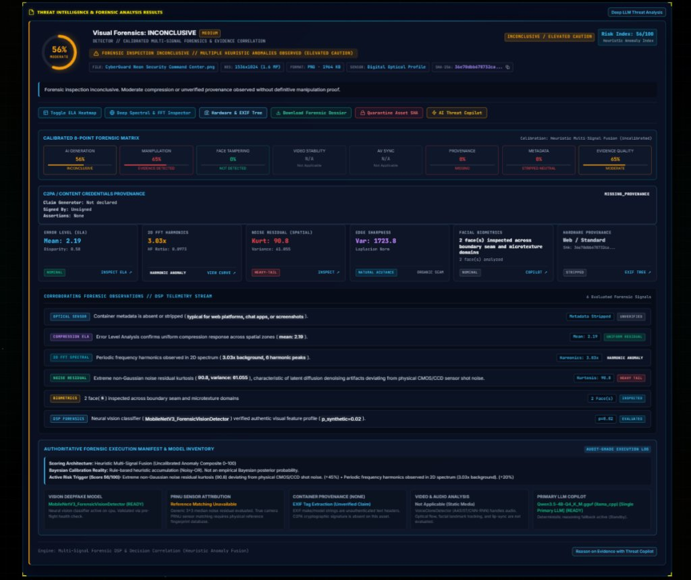
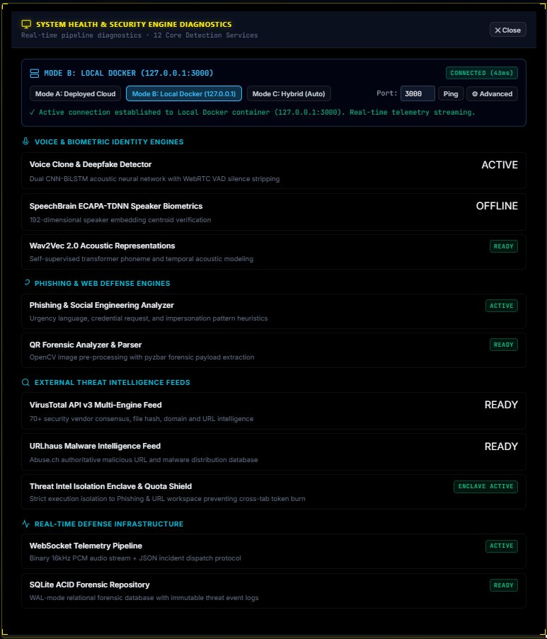
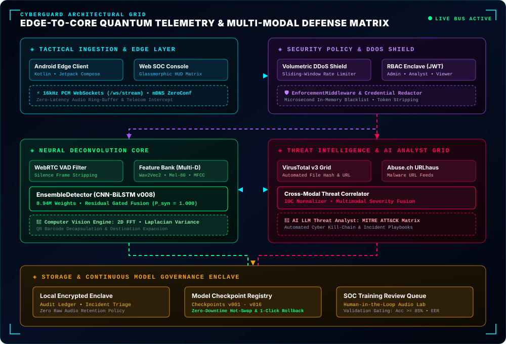
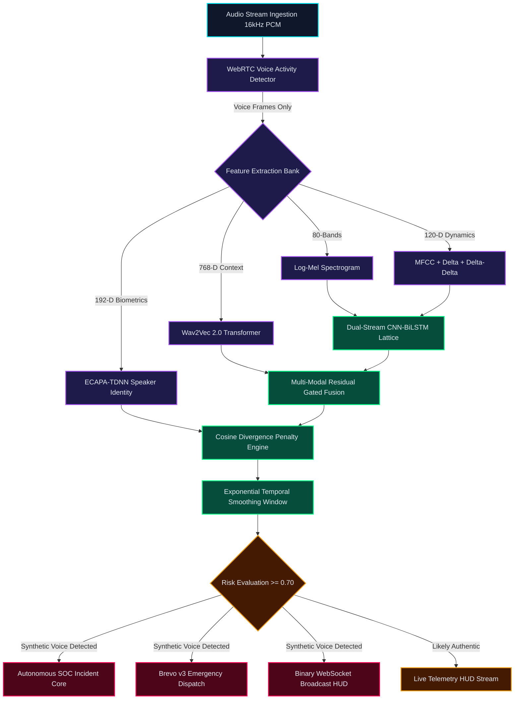
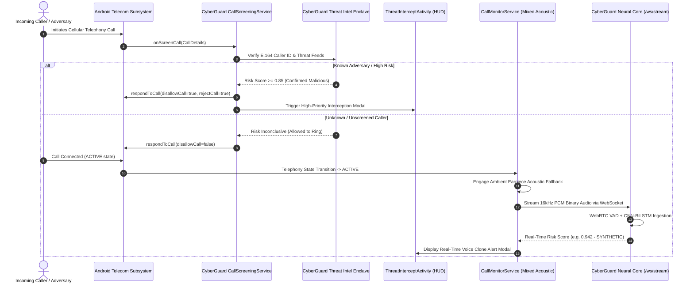
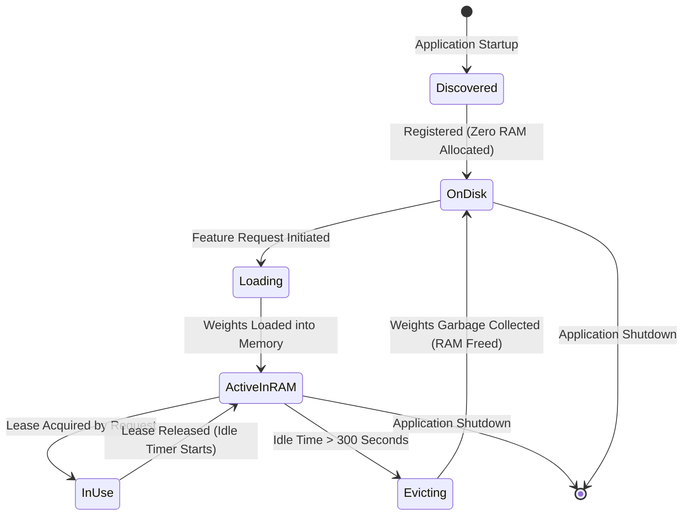

<p align="center">
  
</p>

<div align="center">

# ◈ CYBERGUARD // SOVEREIGN NEURAL DEFENSE GRID
### *SOC Threat Intelligence & Multi-Modal AI Defense Console — Edge-to-Core Autonomous Defense Matrix*

```
  [ CLASSIFICATION: SOVEREIGN // DEFENSE GRADE ] ── [ AUTONOMOUS LEVEL 5 ] ── [ DEFENSE GRID: ACTIVE ]
```

<p align="center">
  <a href="#directive"></a>
  <a href="#vectors"></a>
  <a href="#vectors"></a>
  <a href="#vectors"></a>
  <a href="#vectors"></a>
  <a href="#ecosystem"></a>
  <a href="#ecosystem"></a>
  <a href="#license"></a>
</p>

---

<p align="center">
  <code><b>[ TACTICAL JUMP MATRIX ]</b></code><br>
  <a href="#overview"><code>01. OVERVIEW</code></a> •
  <a href="#directive"><code>02. DIRECTIVE</code></a> •
  <a href="#vectors"><code>03. VECTORS</code></a> •
  <a href="#ecosystem"><code>04. ECOSYSTEM</code></a> •
  <a href="#showcase"><code>05. SHOWCASE</code></a> •
  <a href="#topology"><code>06. TOPOLOGY</code></a> •
  <a href="#pipelines"><code>07. PIPELINES</code></a> •
  <a href="#tech-stack"><code>08. TECH STACK</code></a><br>
  <a href="#workflows"><code>09. WORKFLOWS</code></a> •
  <a href="#installation"><code>10. INSTALLATION</code></a> •
  <a href="#configuration"><code>11. CONFIGURATION</code></a> •
  <a href="#execution"><code>12. EXECUTION</code></a> •
  <a href="#deployment"><code>13. DEPLOYMENT</code></a> •
  <a href="#security"><code>14. SECURITY</code></a> •
  <a href="#structure"><code>15. STRUCTURE</code></a><br>
  <a href="#api"><code>16. API & WS</code></a> •
  <a href="#verification"><code>17. VERIFICATION</code></a> •
  <a href="#limitations"><code>18. LIMITATIONS</code></a> •
  <a href="#roadmap"><code>19. ROADMAP</code></a> •
  <a href="#contributing"><code>20. CONTRIBUTING</code></a> •
  <a href="#license"><code>21. LICENSE</code></a> •
  <a href="#status"><code>22. STATUS</code></a>
</p>

</div>

---

<a id="overview"></a>
## ◈ EXECUTIVE & TECHNICAL OVERVIEW

### 1. Executive Summary (Enterprise & Decision-Makers)
**CyberGuard** is an autonomous, multi-modal Security Operations Center (SOC) threat intelligence and defensive artificial intelligence platform engineered to neutralize modern asymmetric cyber attacks. As adversaries deploy real-time voice clones (neural vocoders like RVC and Diff-TTS), diffusion-synthesized deepfake media, weaponized matrix barcodes ("quishing"), credential phishing vectors, and obfuscated malware payloads, traditional perimeter firewalls and signature-only defenses fail.

CyberGuard establishes an integrated, defense-in-depth shield that unifies:
- **Instantaneous Voice Impersonation Neutralization:** Defends executive leadership and telephony channels against AI voice fraud before or during calls.
- **Forensic Vision & Media Verification:** Unmasks generative diffusion tampering and synthetic portraits using mathematical signal deconvolution.
- **Multi-Engine Static Malware Disassembly:** Dissects executables and archives with native YARA pattern matching and ClamAV heuristics without dangerous live execution.
- **Sovereign Local Reasoning:** Employs an on-premises cognitive AI co-analyst to synthesize alerts and generate automated incident response playbooks without cloud privacy leakage.
- **Zero-Trust Multi-Tenant Architecture:** Ensures complete physical database isolation and zero persistent media retention across all analyzed inputs.

### 2. Deep Technical Summary (Security Engineers & Researchers)
CyberGuard's architecture operates as an **Edge-to-Core Reactive Defense Grid**. The core backend is constructed in Python 3.12 with asynchronous FastAPI and Uvicorn, serving sub-second binary WebSocket audio ingestion (`/ws/stream`) alongside comprehensive RESTful forensic endpoints.

```
┌────────────────────────────────────────────────────────────────────────────────────────────────────────┐
│                                   CYBERGUARD ACTIVE TELEMETRY BUS                                      │
├────────────────────────────────┬───────────────────────────┬──────────────┬────────────────────────────┤
│ SUBSYSTEM / PIPELINE           │ ACTIVE ENGINE / CHECKPOINT│ STATE        │ TARGET SPECIFICATION       │
├────────────────────────────────┼───────────────────────────┼──────────────┼────────────────────────────┤
│ 🧠 Acoustic Neural Core        │ detector.pt (v032)        │ ACTIVE/READY │ 8,941,976 Weights (35.8 MB)│
│ 👤 Biometric Voice Vault       │ SpeechBrain ECAPA-TDNN    │ READY (LAZY) │ 192-D Cosine Centroid      │
│ 🌊 Contextual Audio Encoder    │ Wav2Vec 2.0 (Transformer) │ READY (LAZY) │ 768-D Latent Acoustic Rep  │
│ 🔬 Vision Neural Classifier    │ vision_detector.pt        │ ACTIVE/READY │ MobileNetV3 (4.14 MB)      │
│ 📐 Signal Processing DSP       │ 2D FFT + ELA + PRNU Kurt. │ CALIBRATED   │ Hann Window & Disparity    │
│ 🛡️ Malware Analysis Lab        │ ClamAV + Native YARA 4.5.4│ ARMED        │ PE64/ELF/Mach-O Static     │
│ 🤖 Cognitive AI Copilot        │ Qwen3.5-4B-Q4_K_M.gguf    │ STANDBY/LAZY │ Local GGUF via llama_cpp   │
│ 🌐 Threat Intelligence Enclave │ VirusTotal v3 + URLhaus   │ ENCLAVED     │ Boundary Quota Shield      │
│ 📞 Telecom Call Interceptor    │ Android CallScreeningCore │ ENGAGED      │ Kernel Caller ID & VAD     │
│ 🛰️ Subnet Discovery Beacon     │ _cyberguard._tcp.local.   │ ACTIVE       │ Multicast DNS ZeroConf     │
│ ✉️ Transactional Alert Grid    │ Brevo REST API v3         │ ARMED        │ High/Crit Gated Dispatch   │
│ 🔒 Multi-Tenant Data Vault     │ Per-User SQLite Databases │ ISOLATED     │ Zero Raw Media Retention   │
└────────────────────────────────┴───────────────────────────┴──────────────┴────────────────────────────┘
```

<details>
<summary><strong>▶ CLICK TO EXPAND TELEMETRY SENSOR SPECIFICATIONS &amp; BUFFER GEOMETRY</strong></summary>

<br>

| Telemetry Sensor | Operational Core | Sampling / Precision | Architectural Geometry &amp; Buffer Spec |
| :--- | :--- | :--- | :--- |
| 🎙️ **Acoustic Ingestion** | WebRTC VAD + RingBuffer | 16,000 Hz 16-bit Mono | 32,000 samples/window (2.0s) • 25,600 samples overlap (80%) • 50ms frame step |
| 🎛️ **Spectrographic Filter** | 80-Band Mel Filterbank | FFT Size 1024 / Hop 256 | Frequency span: 0 Hz – 8,000 Hz • Normalized log-energy distribution |
| 📐 **Cepstral Dynamics** | 40-D MFCC + $\Delta$ + $\Delta\Delta$ | 120 Dimensions total | Frame window 25ms • Pre-emphasis filter $\alpha = 0.97$ • Liftering coefficient 22 |
| 🧬 **Contextual Encoders** | Wav2Vec 2.0 (`wav2vec2-base`)| 768-D Latent Tensor | 12 Transformer blocks • 8 Attention heads • Gelu activation |
| 👤 **Identity Biometrics** | ECAPA-TDNN (`voxceleb`) | 192-D Speaker Embedding | Squeeze-and-Excitation channel attention • Cosine consistency gate $\ge 0.75$ |
| 🔬 **Vision Frequency Grid** | 2D Fast Fourier Transform | $512 \times 512$ Hann Window | High-frequency radial attenuation scan • Periodic harmonic spike detector |
| 🖼️ **Compression Disparity** | Error Level Analysis (ELA) | Re-compression Quality 95 | Disparity matrix variance $< 8.0$ nominal • Localized boundary seam delta |
| 📊 **Noise Residual Kurtosis**| 3x3 Median Filter Residual | Non-Gaussian Kurtosis $\kappa$| Physical sensor noise $\kappa \in [3, 15]$ • Diffusion artifact $\kappa > 50$ |
| 📱 **Matrix Decapsulator** | OpenCV + PyZbar Computer Vision| Adaptive Threshold Binarization| Headless recursive redirect traversal • Shannon entropy threshold $> 4.8$ |
| 🛡️ **Static Binary Audit** | PE/ELF Dissector + YARA 4.5 | Byte-Frequency Distribution | Shannon Entropy $H(X) \in [0.0, 8.0]$ • Header PE32/PE64 sanity verification |

</details>

---

<a id="directive"></a>
## ◈ TACTICAL DIRECTIVE & DEFENSE POSTURE

<table width="100%">
  <tr>
    <td width="24%" align="center">
      <br><br>
      <br>
      <br>
      <br>
      
    </td>
    <td>
      <strong>⚡ THREAT ENVIRONMENT // SOVEREIGN SECURITY DIRECTIVE</strong><br><br>
      The weaponization of generative artificial intelligence has dissolved traditional trust assumptions across all communication surfaces:
      <ul>
        <li><strong>Real-Time Voice Impersonation:</strong> Adversaries clone authorized voices in under 3 seconds to execute fraudulent CEO authorization wire requests and bypass telephonic helpdesk controls.</li>
        <li><strong>Synthetic Media Splices:</strong> Adversarial diffusion models generate photo-realistic identity documents, falsified surveillance imagery, and synthetic visual personas that deceive human operators.</li>
        <li><strong>Matrix Quishing Vectors:</strong> Malicious QR codes evade text-based mail filtering, decapsulating into obfuscated multi-hop redirect chains that target mobile credential stores.</li>
        <li><strong>Obfuscated Binary Payloads:</strong> High-entropy packed droppers leverage anti-analysis techniques to bypass cloud antivirus gateways.</li>
      </ul>
      <strong>CYBERGUARD</strong> enforces an uncompromising defense posture across three operational containment modes:
      <ul>
        <li><code>OBSERVE</code>: Passively inspects multi-modal telemetry and logs threat detections without applying active containment.</li>
        <li><code>ASSISTED</code>: Generates reversible containment proposals and remediation playbooks for human SOC analyst sign-off.</li>
        <li><code>ENFORCE</code>: Autonomously blocks high-confidence threats, revokes active sessions, and dispatches immediate incident alerts.</li>
      </ul>
    </td>
  </tr>
</table>

---

<a id="vectors"></a>
## ◈ CORE CAPABILITIES // DEFENSE VECTORS

### 1. 🎙️ Acoustic Voice Clone Interceptor & Neural Deconvolution
- **Dual-Stream CNN-BiLSTM Core (`detector.pt v032`):** Processes incoming audio through parallel convolutional blocks extracting 80-band Log-Mel spectrograms and 120-dimensional cepstral dynamics ($\text{MFCC} + \Delta + \Delta\Delta$).
- **Gated Multi-Modal Fusion:** Concatenates dual spectral representations with 768-dimensional contextual features from Wav2Vec 2.0 transformer backbones and 192-dimensional ECAPA-TDNN speaker biometric embeddings.
- **Sub-Second Streaming Evaluation:** Consumes 16,000 Hz 16-bit Mono PCM frames over low-latency binary WebSockets (`/ws/stream`) using continuous WebRTC Voice Activity Detection (VAD) silence stripping, 2.0-second sliding windows, and 80% temporal overlap.
- **Autonomous Model Adaptation:** Maintains historical model versions (`v001` through `v032`, ~35.8 MB checkpoints) with zero-downtime hot-swapping and 1-click rollback in the administrative console.

### 2. 👤 Biometric Voice Identity Enclave
- **192-Dimensional Acoustic Embeddings:** Generates cryptographic reference centroids using SpeechBrain's ECAPA-TDNN architecture.
- **Cosine Divergence Penalty:** Dynamically penalizes synthetic voice matches that fail biometric identity consistency ($\cos(\mathbf{e}_{\text{live}}, \mathbf{e}_{\text{ref}}) < 0.75$).
- **Tenant Vault Isolation:** Stores enrolled voiceprints exclusively within the authenticated user's isolated database enclave.

### 3. 🔬 Multi-Modal Visual & Video Forensics Lab
- **MobileNetV3 Neural Classifier (`vision_detector.pt`, 4.14 MB):** Efficient deepfake detection model evaluating authentic visual feature profiles.
- **2D Fast Fourier Transform (FFT) Spectral Analysis:** Hann-windowed frequency deconvolution detecting periodic lattice spikes, high-frequency attenuation, and GAN/diffusion checkerboard artifacts.
- **Error Level Analysis (ELA):** Re-compresses assets at 95% quality to uncover composite manipulation seams and localized compression disparities across spatial blocks.
- **Sensor Noise Residual Kurtosis:** Applies 3x3 median filtering to extract photo-response non-uniformity (PRNU) noise residuals. Physical CMOS/CCD camera sensors display typical kurtosis ($\kappa \in [3, 15]$); diffusion denoising processes trigger extreme non-Gaussian kurtosis ($\kappa > 50$).
- **Facial Boundary Seam Inspection:** Leverages OpenCV Haar cascade classifiers to detect localized edge sharpness disparities (Laplacian variance) across facial contours versus surrounding background textures.
- **C2PA / Content Credentials Qualification:** Inspects embedded metadata manifests. In the absence of an authentic X.509 digital signature, provenance is strictly classified as `UNVERIFIED_MANIFEST` or `MISSING_PROVENANCE` to prevent deceptive claim spoofing.
- **Temporal Video Forensics:** Samples video frames across temporal windows, correlating inter-frame neural risk with temporal stability indices.

### 4. 🛡️ Malware Analysis Lab & Multi-Engine Disassembly
- **Static Multi-Engine Architecture:** Dissects uploaded executables, DLLs, APKs, and archives without dangerous live execution in untrusted environments.
- **Structural PE/ELF/Mach-O Inspection:** Parses section headers, entry points, machine architectures (PE32/PE64), and anomalous section alignments.
- **Real ClamAV Antivirus Engine:** Interacts with local ClamAV (`clamscan.exe`) signature databases to detect known trojans, droppers, and exploits.
- **Native YARA 4.5.4 Ruleset:** Compiles and executes native YARA rules against binary streams for pattern-based malware classification.
- **Shannon Byte Entropy Radar:** Calculates entropy distributions across the full byte spectrum ($H(X) \in [0.0, 8.0]$). Identifies plaintext ($0.0 - 4.0$), standard compiled code ($4.0 - 6.8$), and packed or cryptographically encrypted payloads ($7.2 - 8.0$).
- **Transparent Latency Accounting:** Reports exact per-engine execution latencies alongside total coordinated inspection time.

### 5. 🔍 Phishing, URL & Matrix QR Quishing Defense
- **Shannon Entropy & Brand Spoofing:** Evaluates URL lexical distributions and detects Levenshtein distance typosquatting targeting major enterprise brands.
- **Punycode IDN Homograph Detection:** Unmasks Cyrillic, Greek, and Unicode lookalike character substitution attacks in domain names.
- **Computer Vision Matrix Decapsulator:** Employs OpenCV adaptive thresholding and `pyzbar` to decode QR codes from compressed, angled, or low-contrast camera captures.
- **Headless Recursive Redirect Crawler:** Unravels URL shorteners (bit.ly, tinyurl, t.co) up to 10 redirects deep, scoring destination landing pages before user execution.

### 6. 🌐 Quota-Protected Threat Intelligence Enclave
- **Boundary Execution Shield:** Strictly confines external queries to authorized forensic analysis workflows, preventing internal telemetry from exhausting third-party API quotas.
- **VirusTotal v3 Consensus:** Correlates file SHA-256 hashes, domains, and IP addresses across 70+ authoritative security vendor engines.
- **Abuse.ch URLhaus Real-Time Feed:** Cross-references URLs against active malware payload distribution sites.
- **Cryptographic Deduplication Cache:** Maintains in-memory LRU hash indexes to deliver instant zero-latency responses for previously evaluated artifacts.

### 7. 🤖 Cognitive AI Copilot // Qwen 3.5 4B GGUF
- **Sovereign On-Premise LLM:** Operates `Qwen3.5-4B-Q4_K_M.gguf` (2.55 GB) natively via `llama_cpp` on local hardware, ensuring confidential telemetry never leaves the security perimeter.
- **Automated MITRE ATT&CK Mapping:** Automatically binds forensic findings to authoritative tactics and techniques (e.g., `T1566.002` Spearphishing Link, `T1656` Impersonation, `T1204.001` User Execution).
- **Incident Narrative Generation:** Formulates structured, human-readable forensic briefings and step-by-step containment playbooks.

### 8. 🚨 SOC Incident Governance & Transactional Dispatch
- **Incident Lifecycle Management:** Tracks security events through formal states (`OPEN` ➔ `INVESTIGATING` ➔ `CONTAINED` ➔ `RESOLVED`) with immutable analyst action logs.
- **One-Click Emergency Containment:** Allows immediate global revocation of compromised user sessions and quarantine of affected indicators.
- **Brevo API v3 Alerting Grid:** Dispatches responsive, dark-themed HTML alert briefings to designated SOC analysts, strictly gated to `HIGH` and `CRITICAL` severity incidents to prevent alert fatigue.

### 9. 🔄 Continuous Autonomous Learning & Model Governance
- **Human-in-the-Loop Review Queue:** Stages disputed audio samples for manual analyst attestation (`HUMAN` vs `CLONED`).
- **Background Retraining Engine:** Spawns asynchronous optimization jobs (`RUN_*`) applying representation-preserving fine-tuning with frozen backbone weights.
- **Strict Validation Gate:** Enforces objective promotion criteria (Validation F1 $\ge 0.85$ and decreased Equal Error Rate) before promoting a candidate checkpoint to active production `detector.pt`.

---

<a id="ecosystem"></a>
## ◈ PLATFORM ECOSYSTEM // NODES

```
┌────────────────────────────────────────────────────────────────────────────────────────────────────────┐
│                                   CYBERGUARD ECOSYSTEM TOPOLOGY                                        │
└────────────────────────────────────────────────────────────────────────────────────────────────────────┘

        WEB SOC COMMAND HUD                WINDOWS DESKTOP CONSOLE             ANDROID EDGE COMPANION
     ┌───────────────────────┐            ┌───────────────────────┐           ┌───────────────────────┐
     │  frontend/ (Vanilla)  │            │ desktop/ (Electron 33)│           │ android/ (Compose 2)  │
     │  - Glassmorphic Deck  │            │ - NSIS Standalone EXE │           │ - CallScreeningService│
     │  - 8 Tactical Panels  │            │ - Sandboxed OS Enclave│           │ - Mixed Acoustic Mic  │
     │  - Dual-Mode A/B/C    │            │ - Zero Prerequisites  │           │ - mDNS Auto-Discovery │
     └───────────┬───────────┘            └───────────┬───────────┘           └───────────┬───────────┘
                 │                                    │                                   │
                 │   REST / WebSocket (TLS / mDNS)    │                                   │
                 └──────────────────┬─────────────────┴───────────────────────────────────┘
                                    │
                                    ▼
                         ┌───────────────────────┐
                         │   FASTAPI CORE ENGINE │
                         │  backend/main.py:3000 │
                         └──────────┬────────────┘
                                    │
         ┌──────────────────────────┼──────────────────────────┐
         ▼                          ▼                          ▼
┌───────────────────┐      ┌───────────────────┐      ┌───────────────────┐
│  MODEL REGISTRY   │      │ THREAT INTEL BUS  │      │ TENANT DATA VAULT │
│  - Lazy-Loading   │      │ - VirusTotal v3   │      │ - SQLite Enclaves │
│  - 300s Eviction  │      │ - URLhaus Payload │      │ - Supabase Sync   │
│  - Zero RAM Idle  │      │ - OSINT Scrapers  │      │ - Zero Retention  │
└───────────────────┘      └───────────────────┘      └───────────────────┘
```

### 1. Web SOC Command HUD (`frontend/`)
- Pure ES6+ Single Page Application with CSS3 glassmorphism and Chart.js 4.4.0 visualizations.
- Requires **zero frontend build steps** (no `node_modules`, Webpack, or Vite needed to serve).
- Features dynamic dual-mode connectivity:
  - **Mode A (Deployed Cloud):** Connects to cloud origin without requiring local Docker.
  - **Mode B (Local Docker 127.0.0.1:3000):** Connects to local Docker container with bounded auto-reconnection (5s to 30s).
  - **Mode C (Hybrid Auto):** Automatically probes local port 3000, gracefully falling back to cloud.

### 2. Personal Security Web HUD (`frontend-personal/`)
- Purpose-built consumer and employee interface streamlining deepfake audio scanning, phishing URL validation, and suspicious QR payload extraction into a simplified interface.

### 3. Windows Desktop SOC Console (`desktop/`)
- Packaged with **Electron 33.2.1** and **electron-builder 25.1.8** into a native 64-bit NSIS installer (`dist/windows/CyberGuard-Setup.exe`, ~79 MB).
- Fully self-contained with zero external dependencies (no Python, Node.js, or Docker required on target machine).
- Built on strict security primitives: `contextIsolation: true`, `nodeIntegration: false`, and OS-level Chromium sandboxing.

### 4. Android Tactical Edge Companion (`android/`)
- Native mobile application engineered in **Kotlin 2.x**, **Jetpack Compose** (BOM 2024.02.00), and Coroutines/Flow for Android 7.0+ (API 24 to 34).
- **Telecom Kernel Interception:** Employs Android `CallScreeningService` to inspect caller identity before the handset rings.
- **Ambient Mixed Acoustic Fallback:** Uses `CallMonitorService` to capture ambient speakerphone resonance through the microphone during active phone calls when direct telephony audio tapping is restricted by OS privacy sandboxes.
- **mDNS ZeroConf Auto-Discovery:** Discovers local CyberGuard servers on the Wi-Fi subnet (`_cyberguard._tcp.local.`) without manual IP configuration.

### 5. Central Model Registry & Resource-Efficient Lazy Loading (`backend/services/model_registry.py`)
- Discovers and registers all model services at startup without consuming unnecessary memory.
- Heavy neural checkpoints (`detector.pt`, `vision_detector.pt`, `Qwen3.5-4B-Q4_K_M.gguf`, `ECAPA-TDNN`) remain on disk until their respective forensic feature is requested.
- Automatic idle eviction unloads idle weights from RAM after 300 seconds of inactivity using thread-safe reference-counted leases.

---

<a id="showcase"></a>
## ◈ VISUAL PRODUCT SHOWCASE

### 1. Malware Analysis Lab Console
*Static PE/ELF Dissection • ClamAV & YARA 4.5.4 Consensus • Shannon Entropy Byte Radar (6.50 / 8.00 NORMAL)*

<p align="center">
  
</p>

> **Operational Insight:** The Malware Analysis Lab evaluates untrusted binaries (e.g. `kryptex-setup-latest-v5.exe` PE64) through coordinated static analysis engines. ClamAV local antivirus and native YARA rules execute in parallel with PE structural parsing and Shannon byte entropy analysis, reporting transparent per-engine latencies and exact byte-level diagnostic evidence.

---

### 2. Threat Defense Matrix Console
*Unified Multi-Modal Defense Deck: Phishing & Text • AI Media Forensics • QR Quishing • Threat Intelligence Enclave*

<p align="center">
  
</p>

> **Operational Insight:** The central Threat Defense Matrix provides rapid multi-modal threat intake. Analysts can simultaneously paste suspicious emails, drop image/video media for forensic frequency deconvolution, inspect QR codes with recursive redirect unraveling, or query indicators of compromise (IOCs) against isolated global threat feeds.

---

### 3. Deep Threat Intelligence & Forensic Analysis Results
*Primary Classification Hero Banner • Calibrated 8-Point Matrix • C2PA Provenance • DSP Telemetry Stream*

<p align="center">
  
</p>

> **Operational Insight:** When multi-signal forensic analysis evaluates media with conflicting signals (e.g. clean MobileNetV3 visual classification $p_{\text{synthetic}} = 0.02$ alongside heavy spatial noise residual kurtosis of $90.8$ and $3.03\times$ frequency harmonics), CyberGuard transparently correlates the evidence as `INCONCLUSIVE // ELEVATED CAUTION`. The comprehensive dossier provides an authoritative execution manifest, C2PA qualification, and one-click deep reasoning with the local Qwen 3.5 Copilot.

---

### 4. System Health & Security Engine Diagnostics
*Mode B Local Docker Integration • 12 Core Detection Services • Real-Time Engine Availability Attestation*

<p align="center">
  
</p>

> **Operational Insight:** The System Health & Diagnostics console displays real-time operational telemetry across all 12 core engines. It verifies active connectivity to local Docker or cloud nodes, validates lazy-loading model readiness (`ACTIVE`, `READY`, `OFFLINE`), and confirms the boundary isolation shield protecting threat intelligence quotas.

---

<a id="topology"></a>
## ◈ ARCHITECTURAL TOPOLOGY // EDGE-TO-CORE GRID

<p align="center">
  
</p>

```
┌────────────────────────────────────────────────────────────────────────────────────────────────────────┐
│                                   CYBERGUARD DEFENSE TOPOLOGY                                          │
└────────────────────────────────────────────────────────────────────────────────────────────────────────┘

     MOBILE EDGE NODES                       PERIMETER SHIELD                      CORE REASONING GRID
 ┌───────────────────────┐               ┌───────────────────────┐              ┌───────────────────────┐
 │   Android Edge Node   │               │  Enforcement Barrier  │              │   Acoustic AI Core    │
 │ (Jetpack Compose 2.x) │  HTTP/2 JSON  │  - Sliding Rate Limit │ Zero-Copy    │  - 8.94M CNN-BiLSTM   │
 │ - Telecom Screener    │──────────────▶│  - Reverse Proxy Auth │─────────────▶│  - Wav2Vec2 + ECAPA   │
 │ - 16kHz PCM Streamer  │   WebSocket   │  - Brute-Force Shield │  Memory Bus  │  - WebRTC VAD Filter  │
 │ - Package Provenance  │               │  - PII Auto-Redaction │              └───────────┬───────────┘
 └───────────┬───────────┘               └───────────────────────┘                          │
             │                                       │                                      ▼
             │ mDNS Discovery                        │ Isolated Scope           ┌───────────────────────┐
             │ (_cyberguard._tcp)                    ▼                          │ Cognitive Neural LLM  │
             ▼                           ┌───────────────────────┐              │  - Qwen3.5 4B GGUF    │
 ┌───────────────────────┐               │ Threat Intel Enclave  │              │  - MITRE ATT&CK Map   │
 │   Web SOC HUD Node    │  WebSockets   │  - VirusTotal v3 (70+)│◀─────────────│  - Kill-Chain Builder │
 │ (Glassmorphic Deck)   │──────────────▶│  - URLhaus Active IOCs│ Synchronous  │  - Response Playbooks │
 │ - Audio Oscilloscope  │  REST v3 JSON │  - Live Feed Scraper  │ Telemetry    └───────────┬───────────┘
 │ - 8 Tactical Panels   │               │  - Quota Guard Cache  │                          │
 └───────────────────────┘               └───────────────────────┘                          ▼
                                                     │                          ┌───────────────────────┐
                                                     ▼                          │ Tenant Storage Matrix │
                                         ┌───────────────────────┐              │  - Per-User SQLite DB │
                                         │  Alert Dispatch Grid  │              │  - RAM Scratch Purge  │
                                         │  - Brevo API v3       │◀─────────────│  - Model Checkpoints  │
                                         │  - Dynamic Recipients │ Synchronous  │  - Tamper Audit Log   │
                                         │  - High/Crit Gated    │ Dispatch     └───────────────────────┘
                                         └───────────────────────┘
```

---

<a id="pipelines"></a>
## ◈ INTERACTIVE PIPELINE FLOWCHARTS

### 1. Multi-Modal Threat Detection & Neural Fusion Lattice


### 2. Android Telecom Interception & Mixed Acoustic Fallback


### 3. ModelRegistry Lazy-Loading & Idle Eviction Lifecycle


---

<a id="tech-stack"></a>
## ◈ TECHNOLOGY STACK // VERIFIED DEPENDENCIES

| Category | Component / Library | Verified Version | Tactical Responsibility |
| :--- | :--- | :---: | :--- |
| **Runtime & Language** | Python | `3.12.x` | High-performance asynchronous backend runtime |
| **Asynchronous Web** | FastAPI | `>=0.110.0` | ASGI RESTful API framework with automatic OpenAPI documentation |
| **ASGI Web Server** | Uvicorn | `>=0.27.0` | Ultra-fast ASGI server with WebSocket protocol support |
| **WebSocket Engine** | websockets | `>=12.0` | High-throughput binary 16kHz PCM audio streaming bridge |
| **Deep Learning Core** | PyTorch (CPU) | `>=2.2.0` | Neural tensor computing for CNN-BiLSTM and MobileNetV3 |
| **Audio Tensor Core** | TorchAudio | `>=2.2.0` | Hardware-accelerated spectrographic transforms and filters |
| **Transformers** | Hugging Face Transformers | `>=4.38.0` | Wav2Vec 2.0 contextual acoustic representation extraction |
| **Speaker Biometrics** | SpeechBrain | `>=1.0.0` | 192-D ECAPA-TDNN speaker embedding extraction |
| **Digital Signal DSP** | Librosa & SciPy | `>=0.10.1` / `>=1.12.0` | Mel filterbanks, MFCC dynamics, 2D FFT, and noise kurtosis |
| **Voice Activity VAD** | WebRTC VAD | `>=2.0.14` | Kernel-grade vocal frame segmentation and silence stripping |
| **Audio I/O & Codecs** | SoundFile & imageio-ffmpeg | `>=0.12.1` / `>=0.5.1` | Multi-format multimedia parsing (WAV, MP3, MP4, MKV, OGG) |
| **Static Malware Core**| YARA-Python | `>=4.5.0` | Native compiled signature pattern matching for malware binaries |
| **Antivirus Daemon** | ClamAV (`clamscan`) | `1.0.x / 1.4.x` | Local database antivirus signature scanning engine |
| **Computer Vision** | OpenCV Headless & Pillow | `>=4.9.0` / `>=10.2.0` | Image transforms, ELA disparity, Haar face boundaries |
| **Matrix Barcodes** | PyZbar & QRCode | `>=0.1.9` / `>=7.4.2` | Computer vision matrix barcode decapsulation and generation |
| **Cognitive Copilot** | llama-cpp-python | `>=0.2.75` | Local GGUF quantized inference for Qwen 3.5 4B |
| **Database & ORM** | SQLAlchemy & AioSQLite | `>=2.0.28` / `>=0.20.0`| Multi-tenant SQLite database isolation and async access |
| **Cloud Database Sync**| Psycopg2 Binary | `>=2.9.9` | Bidirectional PostgreSQL synchronization with Supabase |
| **Service Discovery** | Zeroconf | `>=0.132.0` | Local subnet Multicast DNS (`_cyberguard._tcp.local.`) |
| **Transactional Mail** | Brevo REST API v3 | `v3 (REST)` | Zero-cost transactional security alert dispatch |
| **Desktop Client** | Electron & Electron-Builder | `33.2.1` / `25.1.8` | Cross-platform desktop application packaged with NSIS |
| **Mobile Edge Client** | Kotlin & Jetpack Compose | `2.x` / `2024.02.00` | Native Android edge client with CallScreeningService |

---

<a id="workflows"></a>
## ◈ FEATURE WORKFLOWS // EXECUTION SEQUENCES

### 1. Real-Time Streaming Voice Interception
1. **Connection Handshake:** Web or Android client initiates an authenticated WebSocket connection to `/ws/stream`.
2. **Session Initialization:** Backend allocates an isolated `AudioRingBuffer` with a 2.0-second temporal receptive field.
3. **PCM Stream Ingestion:** Client streams chunked 16,000 Hz 16-bit Mono PCM binary buffers.
4. **Silence Stripping:** WebRTC VAD assesses incoming 30ms frames; non-vocal frames are stripped to avoid skewing predictions.
5. **Feature Extraction:** Vocal frames are transformed into 80-band Mel filterbanks, 120-D MFCCs, Wav2Vec 2.0 context vectors, and ECAPA-TDNN embeddings.
6. **Ensemble Scoring:** Dual-stream CNN-BiLSTM lattice computes raw synthetic probability.
7. **Biometric Consistency Check:** If reference speaker enrolled, cosine similarity penalty is calculated and combined.
8. **Temporal Smoothing:** Exponential smoothing filter updates rolling risk score, emitting telemetry events back over the WebSocket.

### 2. Multi-Engine Static Malware Inspection
1. **Artifact Intake:** User drops binary artifact (EXE, DLL, ELF, APK, ZIP) into the Malware Lab workspace.
2. **Cryptographic Fingerprinting:** File stream is hashed (SHA-256) and inspected for file size, MIME type, and magic bytes.
3. **PE/ELF Dissection:** Static parser extracts binary architecture (PE32/PE64), section headers, and entropy distribution.
4. **Shannon Entropy Radar:** Computes byte-frequency entropy across all binary sections; flags high-entropy packing ($>7.2$).
5. **Native YARA Execution:** Compiles active YARA ruleset and scans binary byte stream for pattern matches.
6. **ClamAV Antivirus Check:** Hands binary off to local ClamAV scanner for database signature verification.
7. **Threat Intelligence Correlation:** Queries VirusTotal v3 and URLhaus caches using the SHA-256 fingerprint.
8. **Consolidated Verdict:** Multi-engine verdict engine weights findings, reporting transparent per-engine latencies.

### 3. Multi-Signal Media Forensics Pipeline
1. **Visual Media Upload:** Image or video artifact uploaded to `/api/threats/media`.
2. **Neural Classification:** MobileNetV3 visual deepfake classifier calculates authentic visual feature probability $p_{\text{synthetic}}$.
3. **2D FFT Frequency Analysis:** 2D Fast Fourier Transform with Hann windowing unmasks high-frequency periodic harmonics.
4. **Error Level Analysis (ELA):** Re-compresses image at 95% quality; calculates disparity matrix across spatial blocks.
5. **Sensor Noise Kurtosis:** 3x3 median filter extracts high-frequency noise residuals; non-Gaussian kurtosis is computed.
6. **Facial Boundary Analysis:** OpenCV Haar detector locates face contours and measures normalized Laplacian variance across skin boundaries.
7. **C2PA Manifest Qualification:** Checks for embedded Content Credentials; assigns `UNVERIFIED_MANIFEST` if cryptographic signature is missing.
8. **Evidence Correlation:** Correlation engine synthesizes neural and heuristic evidence into the primary classification verdict.

### 4. Android Telecom Call Screening & Mixed Acoustic Defense
1. **Telephony Call Trigger:** Cellular network routes incoming phone call to the mobile handset.
2. **Kernel-Level Screening:** Android Telecom subsystem invokes `CyberGuardCallScreeningService.onScreenCall()`.
3. **Threat Intel Lookup:** Normalizes phone number to E.164 and queries local call reputation database and threat feeds.
4. **Autonomous Disposition:**
   - If confirmed malicious ($\text{Risk} \ge 0.85$), call is rejected without ringing and full-screen intercept modal is triggered.
   - If unverified, call is allowed to connect.
5. **Mixed Acoustic Transition:** When call connects (`ACTIVE` state), `CallMonitorService` activates ambient acoustic capture.
6. **Real-Time Analysis:** Streams audio to CyberGuard backend `/ws/stream`; displays floating voice clone warning if impersonation detected.

---

<a id="installation"></a>
## ◈ INSTALLATION & SETUP GUIDE

### Prerequisites
- **Python:** Version `3.12.x` installed (Python 3.12 recommended for full PyTorch and YARA compatibility).
- **Git:** Git CLI for repository cloning.
- **Node.js (Optional, Desktop):** Node.js 18+ and npm for building the Electron desktop app.
- **Android Studio (Optional, Mobile):** Android Studio Ladybug/Hedgehog with Android SDK 34 and JDK 17 for the mobile companion.
- **Docker (Optional, Containerized):** Docker Engine 24+ and Docker Compose v2.

---

### Step 1: Clone the Repository
```bash
git clone https://github.com/Arthur-2407/CyberGuard.git
cd CyberGuard
```

---

### Step 2: Backend Setup (Local Python Environment)

#### Windows (PowerShell):
```powershell
# 1. Create isolated virtual environment
python -m venv venv

# 2. Activate virtual environment
.\venv\Scripts\Activate.ps1

# 3. Install PyTorch CPU wheels (recommended for standard hardware)
pip install --extra-index-url https://download.pytorch.org/whl/cpu torch torchaudio

# 4. Install backend dependencies
pip install -r backend\requirements.txt

# 5. Launch development server on port 3000
python -m uvicorn backend.main:app --host 0.0.0.0 --port 3000 --reload
```

#### Linux / macOS (Bash):
```bash
# 1. Create virtual environment
python3 -m venv venv

# 2. Activate virtual environment
source venv/bin/activate

# 3. Install PyTorch CPU wheels
pip install --extra-index-url https://download.pytorch.org/whl/cpu torch torchaudio

# 4. Install dependencies
pip install -r backend/requirements.txt

# 5. Launch server
python -m uvicorn backend.main:app --host 0.0.0.0 --port 3000 --reload
```

---

### Step 3: Web SOC Frontend Access
- **Local Browser:** Navigate to `http://127.0.0.1:3000` to open the full glassmorphic SOC console.
- **Production Cloud Mirror:** Access the 24/7 web console at [https://cyber-guard-backend-ashen.vercel.app](https://cyber-guard-backend-ashen.vercel.app).
- **Static GitHub Pages Mirror:** Access [https://arthur-2407.github.io/CyberGuard](https://arthur-2407.github.io/CyberGuard).

---

### Step 4: Windows Desktop SOC Console (NSIS Installer)

```bash
cd desktop

# Install Electron build dependencies
npm install

# Build standalone Windows NSIS installer
npm run dist

# Output artifact: dist/windows/CyberGuard-Setup.exe (~79 MB)
```
- Run `CyberGuard-Setup.exe` to install the sandboxed desktop console with Start Menu and Desktop shortcuts.

---

### Step 5: Android Tactical Companion (Mobile APK)

```bash
cd android

# Run unit tests
./gradlew testDebugUnitTest

# Build debug APK
./gradlew assembleDebug

# Output artifact: android/app/build/outputs/apk/debug/app-debug.apk
```
- Install onto target Android device running Android 7.0 (API 24) or newer.

---

### Step 6: Docker Containerized Deployment

```bash
# Build and start CyberGuard backend container on port 3000
docker compose up -d --build cyberguard-backend

# Verify running container
docker compose ps

# View container logs
docker compose logs -f cyberguard-backend

# Stop container
docker compose down
```

---

<a id="configuration"></a>
## ◈ ENVIRONMENT CONFIGURATION

CyberGuard uses environment variables to configure external threat feeds, database persistence, and transactional email alerting. 

Copy `.env.example` to `.env` in the repository root:

```bash
cp .env.example .env
```

### Configuration Parameters

| Environment Variable | Default / Format | Description &amp; Security Requirements |
| :--- | :--- | :--- |
| `DATABASE_URL` | *(empty = SQLite)* | Optional Supabase PostgreSQL connection string (`postgresql+psycopg2://...`). If left empty, CyberGuard automatically initializes isolated multi-tenant SQLite databases. |
| `EMAIL_ENABLED` | `true` | Master toggle for transactional email alerting. |
| `EMAIL_PROVIDER` | `brevo` | Transactional email provider (`brevo` supported natively). |
| `BREVO_API_KEY` | *(your_brevo_api_key)* | Brevo API v3 key for dispatching security incident notifications. |
| `EMAIL_FROM` | `alerts@cyberguard.local` | Verified sender email address configured in Brevo. |
| `EMAIL_FROM_NAME` | `CyberGuard Security` | Friendly display name for dispatched email alerts. |
| `EMAIL_ALERT_RECIPIENTS`| `soc@company.com` | Comma-separated list of security analysts receiving alerts. |
| `EMAIL_ALERT_THRESHOLD` | `85` | Minimum risk score ($0 - 100$) required to trigger an email alert. |
| `EMAIL_ALERT_MIN_SEVERITY`| `HIGH` | Minimum severity level (`HIGH` or `CRITICAL`) required to trigger dispatch. |
| `EMAIL_DAILY_LIMIT` | `250` | Daily dispatch limit to prevent exhausting free-tier quotas (300/day). |
| `VIRUSTOTAL_ENABLED` | `true` | Enables VirusTotal v3 cryptographic hash and URL lookups. |
| `VIRUSTOTAL_API_KEY` | *(your_vt_api_key)* | VirusTotal v3 API key (queries isolated within `ThreatIntelEnclave`). |
| `URLHAUS_ENABLED` | `true` | Enables Abuse.ch URLhaus malicious payload queries. |
| `URLHAUS_AUTH_KEY` | *(optional)* | Optional Abuse.ch authentication token for enhanced rate limits. |
| `CYBERGUARD_ADMIN_PASSWORD`| *(optional)* | Initial bootstrap password for the `admin` account. If left blank, a cryptographically random 24-character one-time secret is generated and saved to `data/.admin_bootstrap_credentials`. |

> [!IMPORTANT]
> **Zero-Secret Guarantee:** Never commit real API keys, passwords, or tokens to version control. The repository `.gitignore` strictly excludes `.env`, `data/user_databases/`, and all temporary evidence scratch buffers.

---

<a id="execution"></a>
## ◈ RUNNING CYBERGUARD // OPERATIONAL MODES

CyberGuard supports four operational modes tailored to different deployment scenarios:

### 1. Mode A — Deployed Cloud (24/7 Public Access)
- Default mode for external visitors.
- Frontends on [Vercel](https://cyber-guard-backend-ashen.vercel.app) or [GitHub Pages](https://arthur-2407.github.io/CyberGuard) connect directly to the 24/7 Render cloud API backend (`https://cyberguard-backend-8rbz.onrender.com`).
- Requires zero local compute or Docker containers on the user's machine.

### 2. Mode B — Local Docker (Resource-Efficient Laptop Operation)
- Run the full CyberGuard backend locally in Docker on port `3000`:
  ```powershell
  docker compose up -d
  ```
- Open the web console, click **System Health** in the navigation bar, and select **Mode B: Local Docker (127.0.0.1:3000)**.
- Bounded auto-reconnection monitors port 3000 and connects automatically as soon as Docker starts.
- When finished, stop the container to immediately release all laptop CPU, RAM, and battery resources:
  ```powershell
  docker compose down
  ```

### 3. Mode C — Hybrid Auto (Cloudflare Tunnel Link)
- Seamlessly bridge the public Vercel/GitHub Pages HTTPS frontend to your local Docker backend using the included Cloudflare Tunnel service:
  ```powershell
  .\scripts\docker-manager.ps1 start -Tunnel
  ```
- Retrieve your assigned ephemeral HTTPS tunnel endpoint:
  ```powershell
  .\scripts\docker-manager.ps1 tunnel-url
  ```
- Provides end-to-end TLS encryption without opening or forwarding ports on your router.

### 4. Developer Mode — Native Python Uvicorn
- Ideal for rapid engineering, debugging, and running unit test suites:
  ```powershell
  .\venv\Scripts\python.exe -m uvicorn backend.main:app --host 0.0.0.0 --port 3000 --reload
  ```

---

<a id="deployment"></a>
## ◈ DEPLOYMENT ARCHITECTURE // LIVE ENDPOINTS

```
┌──────────────────────────────────────────────┐       ┌──────────────────────────────────────────────┐
│        Vercel Production Frontend            │       │         GitHub Pages Production Node         │
│  https://cyber-guard-backend-ashen.vercel.app│       │      https://arthur-2407.github.io/CyberGuard│
└───────────────────────┬──────────────────────┘       └───────────────────────┬──────────────────────┘
                        │                                                      │
                        └──────────────────────────┬───────────────────────────┘
                                                   │
                                      (HTTPS / WSS Encrypted Link)
                                                   ▼
                        ┌──────────────────────────────────────────────────────┐
                        │        Cloudflare Secure Ingress Tunnel              │
                        │       https://<assigned>.trycloudflare.com           │
                        └──────────────────────────┬───────────────────────────┘
                                                   │
                                      (Local Docker Bridge Network)
                                                   ▼
                        ┌──────────────────────────────────────────────────────┐
                        │      Your Laptop — Docker Container (On-Demand)      │
                        │               cyberguard-backend:3000                │
                        │   • AASIST SOTA Acoustic Deepfake Neural Core        │
                        │   • Real-Time Binary WebSocket Audio Stream Ingestion│
                        │   • VirusTotal v3 + Abuse.ch URLhaus Enclave Feeds   │
                        │   • Computer Vision QR Forensic Scanning Core        │
                        │   • SQLite Persistent Vault: ./data/cyberguard.db    │
                        └──────────────────────────────────────────────────────┘
```

| Deployment Tier | Live Operational URL | Scope &amp; Target | Availability |
| :--- | :--- | :--- | :---: |
| 🪟 **Windows Desktop Console** | `CyberGuard-Setup.exe` (NSIS) | Native sandboxed SOC HUD with Start Menu &amp; Desktop shortcuts |  |
| ☁️ **Render Cloud Core** | [`https://cyberguard-backend-8rbz.onrender.com`](https://cyberguard-backend-8rbz.onrender.com) | Autonomous 24/7 cloud API &amp; real-time WebSocket backend |  |
| ☁️ **Vercel Cloud HUD** | [`https://cyber-guard-backend-ashen.vercel.app`](https://cyber-guard-backend-ashen.vercel.app) | Public production web console with edge reverse-proxy |  |
| 🌐 **GitHub Pages Mirror** | [`https://arthur-2407.github.io/CyberGuard`](https://arthur-2407.github.io/CyberGuard) | Multi-cloud redundant static frontend mirror |  |
| 💻 **Local Web SOC HUD** | [`http://127.0.0.1:3000`](http://127.0.0.1:3000) | Local development console, audio oscilloscope, &amp; risk gauges |  |
| 📱 **Android Tactical Companion** | `com.cyberguard.client` | Native Jetpack Compose companion with telecom call screening |  |
| 📑 **Interactive OpenAPI (Swagger)**| [`https://cyberguard-backend-8rbz.onrender.com/docs`](https://cyberguard-backend-8rbz.onrender.com/docs) | Interactive API schema explorer &amp; endpoint execution console |  |
| 📖 **Alternative ReDoc Console** | [`https://cyberguard-backend-8rbz.onrender.com/redoc`](https://cyberguard-backend-8rbz.onrender.com/redoc) | Offline-capable technical API specification documentation |  |

### GitHub Pages Deployment Lifecycle

The Pages workflow deploys the static `frontend/` site after the main-branch CI pipeline completes successfully. It also supports a manual `workflow_dispatch`. Deployments use a shared `pages` concurrency group with cancellation disabled, so an active deployment is allowed to finish before another starts. This serializes deployment work without deleting deployment history or changing the published site URL.

---

<a id="security"></a>
## ◈ SECURITY, PRIVACY & ZERO-TRUST SOVEREIGNTY

CyberGuard enforces strict enterprise security and data privacy safeguards:

- **Ephemeral Media Processing Directive:** Audio, video, and image forensic inspections operate strictly in-memory or within temporary scratch buffers. All uploaded media buffers are guaranteed to be eradicated in `finally:` blocks. Raw media is **never written to databases or retained on disk**.
- **Physical Multi-Tenant Database Isolation:** Each user account is assigned an isolated SQLite tenant database (`data/user_databases/user_{id}.db`). Incidents, analysis records, and biometrics belonging to User A are physically inaccessible to User B.
- **DDoS Shield & Sliding-Window Rate Limiting:** ASGI middleware enforces sliding-window request rate limits, mitigating denial-of-service attempts and brute-force credential stuffing.
- **Reverse-Proxy Spoofing Protection:** Reverse-proxy headers (`X-Forwarded-For`) are only trusted when originating from explicitly configured IP addresses (`trusted_proxies` in `config.yaml`), falling back to direct socket client IP addresses.
- **Log Parameter Scrubbing:** Built-in regex filters redact API tokens, passwords, authorization bearer headers, and confidential parameters across all server logs.
- **Secure Administrator Bootstrapping:** Default credentials are never stored in source code. On initial bootstrap, the password is read from `CYBERGUARD_ADMIN_PASSWORD` or a cryptographically random 24-character one-time secret is generated and saved to `data/.admin_bootstrap_credentials` with restricted file permissions (`0o600`).
- **Complete Cryptographic Purge (Zero Retention):** When an account is purged, all user credentials, sessions, analysis records, review items, tenant databases, and exclusive media files are permanently and irreversibly eradicated.
- **Administrative Safety Safeguards:** Administrative safeguards prevent self-deletion of the active administrator, prevent deletion of the sole remaining administrator, and protect core system service accounts.

---

<a id="structure"></a>
## ◈ REPOSITORY STRUCTURE

```
CyberGuard/
├── .github/
│   └── workflows/                   # Automated CI/CD pipelines (Windows NSIS build, etc.)
├── android/                         # Native Android Tactical Edge Companion
│   ├── app/
│   │   ├── build.gradle.kts         # Android build configuration (SDK 34, Compose BOM)
│   │   └── src/main/java/com/cyberguard/client/
│   │       ├── audio/               # 16kHz PCM capture & WebSocket audio streaming
│   │       ├── telecom/             # Android Telecom CallScreeningService & caller ID
│   │       ├── service/             # CallMonitorService (mixed acoustic mode fallback)
│   │       ├── network/             # mDNS ZeroConf discovery & REST/WebSocket clients
│   │       └── ui/                  # Jetpack Compose HUD, screens, and modals
├── backend/                         # Core Python FastAPI ASGI Backend
│   ├── analysis/                    # Forensic analysis & detection engines
│   │   ├── deepfake_coordinator.py  # Central forensic coordination hub
│   │   ├── llm_analyst.py           # Cognitive LLM co-analyst & MITRE mapper
│   │   ├── forensics/               # Visual, video, and C2PA forensic engines
│   │   │   ├── c2pa_provenance.py   # C2PA Content Credentials qualification
│   │   │   ├── correlation_engine.py# Multi-signal DSP & neural evidence correlation
│   │   │   ├── image_forensics.py   # 2D FFT, ELA disparity, and PRNU noise kurtosis
│   │   │   └── video_forensics.py   # Multi-frame video temporal deepfake analysis
│   │   └── malware/                 # Malware Analysis Lab static inspection engines
│   │       ├── coordinator.py       # Multi-engine malware analysis coordinator
│   │       ├── clamav_scanner.py    # Local ClamAV signature scanner
│   │       ├── yara_scanner.py      # Native YARA 4.5.4 pattern matching
│   │       └── verdict_engine.py    # Multi-engine evidence weighting & latency
│   ├── api/                         # FastAPI RESTful routers & WebSocket handlers
│   │   ├── routes_auth.py           # JWT authentication, login, registration, and logout
│   │   ├── routes_admin.py          # Model registry, hot-swap promotion, and reviews
│   │   ├── routes_threats.py        # Multi-modal media forensics, URLs, QR, and feeds
│   │   ├── routes_incidents.py      # SOC incident management & containment actions
│   │   ├── routes_speakers.py       # Biometric voice enrollment & verification
│   │   └── routes_alerts_config.py  # System health, telemetry diagnostics, and config
│   ├── detection/                   # Acoustic deepfake neural detection network
│   │   └── detector.py              # CNN-BiLSTM lattice with Gated Multi-Modal Fusion
│   ├── features/                    # Signal processing & feature extractors
│   │   ├── audio_features.py        # 80-band Mel filterbanks & 120-D MFCC dynamics
│   │   ├── speaker_extractor.py     # SpeechBrain ECAPA-TDNN 192-D speaker centroid
│   │   └── wav2vec_extractor.py     # Wav2Vec 2.0 contextual transformer representations
│   ├── models/                      # Deep learning model architectures & weights
│   │   ├── qwen_service.py          # Quantized Qwen 3.5 4B GGUF local inference
│   │   ├── vision_detector.py       # MobileNetV3 visual deepfake classifier
│   │   └── weights/                 # Model checkpoints (detector_v001-v032.pt, etc.)
│   ├── services/                    # Background infrastructure & services
│   │   └── model_registry.py        # Central lazy-loading & 300s idle eviction registry
│   ├── storage/                     # Multi-tenant SQLite database & Supabase sync
│   └── main.py                      # FastAPI application entry point, middleware & WS
├── data/                            # Persistent data vault (tenant SQLite DBs, models)
├── desktop/                         # Native Windows Desktop Application (Electron)
│   ├── main.js                      # Electron main process (contextIsolation, sandbox)
│   ├── preload.js                   # Secure preload bridge
│   └── package.json                 # Electron 33.2.1 & electron-builder NSIS configuration
├── dist/                            # Packaged distribution artifacts (CyberGuard-Setup.exe)
├── docs/                            # Documentation assets, animated SVGs & diagrams
│   └── assets/                      # Animated SVG architecture & neural flow diagrams
│       └── readme/                  # High-resolution product showcase screenshots
├── frontend/                        # Web SOC Command HUD (Vanilla ES6+ SPA)
│   ├── app.js                       # SPA orchestrator, WebSocket stream & forensic UI
│   ├── index.html                   # Glassmorphic SOC dashboard layout (8 panels)
│   └── styles.css                   # Responsive cybernetic theme & CSS animations
├── frontend-personal/               # Consumer & Personal Security Web Portal
├── scripts/                         # Operational management scripts (Docker manager, etc.)
├── tests/                           # Unit, subsystem, and Playwright verification suites
├── .env.example                     # Sanitized environment configuration template
├── config.yaml                      # Core system configuration & security policy thresholds
├── docker-compose.yml               # Multi-container Docker deployment specification
├── Dockerfile                       # Hardened production container build manifest
└── LICENSE                          # MIT Open Source License
```

---

<a id="api"></a>
## ◈ TACTICAL API & REAL-TIME WEBSOCKET MATRIX

<details>
<summary><strong>▶ CLICK TO EXPAND FULL REST &amp; WEBSOCKET PROTOCOL SPECIFICATIONS</strong></summary>

<br>

### 1. Identity &amp; Access Enclave (`/api/auth/*`)
| Method | Endpoint Route | Authorization Level | Tactical Purpose |
| :---: | :--- | :---: | :--- |
|  | `/api/auth/login` |  | Authenticates credentials and issues JWT bearer token |
|  | `/api/auth/register` |  | Registers new operational user account |
|  | `/api/auth/me` |  | Retrieves current user role (`ADMIN`, `ANALYST`, `VIEWER`) |
|  | `/api/auth/logout` |  | Invalidates active user session and bearer claims |

### 2. Admin &amp; Model Governance (`/api/admin/*`)
| Method | Endpoint Route | Authorization Level | Tactical Purpose |
| :---: | :--- | :---: | :--- |
|  | `/api/admin/models` |  | Lists all model checkpoints (`v001` - `v032`), file sizes, and validation metrics |
|  | `/api/admin/models/promote` |  | Atomically promotes candidate model checkpoint to active production `detector.pt` |
|  | `/api/admin/models/rollback`|  | Instantly rolls back active neural detector to specified historical checkpoint version |
|  | `/api/admin/training/trigger`|  | Dispatches background model retraining job with verified review queue dataset |
|  | `/api/admin/reviews` |  | Fetches disputed acoustic samples staged in human-in-the-loop review queue |
|  | `/api/admin/reviews/{id}/decision` |  | Commits verified ground-truth classification (`HUMAN` vs. `CLONED`) to dataset |
|  | `/api/admin/users/{id}` |  | Purges user account, sessions, isolated tenant DB, and owned assets |

### 3. Forensics, Phishing &amp; Malware Analysis (`/api/threats/*`)
| Method | Endpoint Route | Authorization Level | Tactical Purpose |
| :---: | :--- | :---: | :--- |
|  | `/api/threats/unified` |  | Unified cross-modal threat evaluation across audio, URL, QR, and contextual text |
|  | `/api/threats/media` |  | Multi-modal deepfake forensics on audio, image, and video media uploads |
|  | `/api/threats/malware/scan` |  | Coordinated static binary malware audit (PE/ELF, ClamAV, YARA, Shannon entropy) |
|  | `/api/threats/phishing` |  | Evaluates text content for deceptive phishing patterns and social engineering |
|  | `/api/threats/url` |  | Evaluates destination URL for entropy anomalies, punycode spoofing, and feeds |
|  | `/api/threats/qr` |  | Computer vision matrix barcode decapsulation and extracted payload analysis |
|  | `/api/threats/llm-analysis` |  | Sovereign Qwen LLM synthesis, MITRE ATT&amp;CK mapping, and response playbook |
|  | `/api/threats/pipeline/status` |  | Live telemetry status of VirusTotal, URLhaus, and neural detection pipelines |

### 4. Incident Response &amp; Biometrics (`/api/incidents/*` &amp; `/api/speakers/*`)
| Method | Endpoint Route | Authorization Level | Tactical Purpose |
| :---: | :--- | :---: | :--- |
|  | `/api/incidents/` |  | Lists tracked security incidents in the caller's isolated database |
|  | `/api/incidents/dashboard/summary` |  | Fetches aggregate SOC metrics (returns 0-baseline for unauthenticated guests) |
|  | `/api/incidents/{id}/status` |  | Transitions incident state (`OPEN` ➔ `INVESTIGATING` ➔ `CONTAINED` ➔ `RESOLVED`) |
|  | `/api/incidents/containment/emergency` |  | Triggers emergency containment across all active high-critical threats |
|  | `/api/speakers/enroll` |  | Enrolls reference vocal sample into 192-dim ECAPA-TDNN biometric enclave |
|  | `/api/speakers` |  | Lists enrolled biometric speaker identities in caller's tenant database |

### 5. Real-Time Binary WebSocket Protocol (`/ws/stream`)
- **Client (Android / Web HUD) Transmits:**
  - `Binary PCM Frames`: 16,000 Hz 16-bit Mono PCM raw byte stream in chunked buffers.
  - `Control Messages (JSON)`:
    ```json
    { "type": "start_call_monitor", "capture_mode": "MIXED_ACOUSTIC" }
    ```
- **Server (CyberGuard Core) Emits:**
  - `Session Handshake`:
    ```json
    { "type": "session_start", "session_id": "sess_8941", "detector_ready": true, "version": "v032" }
    ```
  - `Voice Activity Telemetry`:
    ```json
    { "type": "status_update", "status": "VOICE_DETECTED" }
    ```
  - `Real-Time Risk Assessment`:
    ```json
    { "type": "risk_update", "risk_score": 0.942, "alert_level": "CRITICAL", "is_synthetic": true }
    ```

</details>

---

<a id="verification"></a>
## ◈ TESTING, VERIFICATION & CI/CD

CyberGuard maintains high verification standards across all backend subsystems, client applications, and deployment targets:

### 1. Backend Subsystem & Unit Test Suite
The repository includes comprehensive automated tests covering the entire detection and forensic pipeline:

```powershell
# Run the complete test suite
.\venv\Scripts\python.exe -m pytest tests/ -v
```

The test suite uses a disposable SQLite database in the system temporary directory, keeping the local `data/cyberguard.db` out of test runs. Coverage includes forensic integrity, image and media pipelines, account lifecycle, email alert persistence, desktop integration, and tenant isolation.

### 2. Live Browser Playwright Verification
End-to-end browser integration is verified on live Chromium instances via Playwright:

```powershell
.\venv\Scripts\python.exe tests/verify_live_browser.py
```
- Launches headless Chromium at `http://127.0.0.1:3000`.
- Validates all 8 tactical tabs: Overview, Threat Monitoring, Voice Analysis, Phishing & URL, Malware Lab, Voice Identity, Security Center, and Continuous Learning.
- Validates modal interactions: System Health diagnostics modal, Primary Classification Hero Banner, and the 7-section More Details forensic dossier.
- Asserts **0 critical JavaScript runtime errors** and **0 uncaught exceptions**.

### 3. Android Mobile Edge Test Suite
```bash
cd android
./gradlew testDebugUnitTest
```
- Validates 22 automated unit tests covering `SmartConnectionManager`, phone number normalization, and call screening policy evaluation.

---

<a id="limitations"></a>
## ◈ KNOWN LIMITATIONS & TRANSPARENT DISCLOSURES

In accordance with strict engineering integrity standards, the following architectural constraints and operational boundaries are transparently disclosed:

1. **CPU Inference Latency on Acoustic Windows:** When running without a dedicated CUDA/MPS GPU accelerator, PyTorch CPU inference for the full CNN-BiLSTM lattice with Mel filterbanks and cepstral extraction requires approximately **400ms – 550ms** per 2.0-second chunk. On low-power hardware, sliding window steps should be configured to 100ms or 200ms.
2. **Heuristic Anomaly Index vs Empirical Bayesian Posterior:** The composite risk score reported for image forensics ($0 - 100$) represents a calibrated multi-signal heuristic accumulation (Noisy-OR model combining 2D FFT harmonics, spatial noise kurtosis, and ELA disparity). It is an engineering anomaly index designed to guide human analyst triage, not an empirical Bayesian posterior probability.
3. **Static Malware Safety Boundary:** The Malware Analysis Lab intentionally limits its evaluation to static structural parsing (PE/ELF headers), signature matching (ClamAV), pattern compilation (YARA 4.5.4), and Shannon entropy calculations. Live dynamic detonation / execution sandboxing is disabled by design to eliminate the risk of host compromise.
4. **Android Telephony Ambient Acoustic Mode:** Due to Android OS privacy sandboxes preventing third-party applications from directly tapping cellular call audio streams, live call defense requires the phone to be in speakerphone mode or held near the ear where the microphone can capture acoustic resonance.

---

<a id="roadmap"></a>
## ◈ FUTURE DEVELOPMENT ROADMAP

- [ ] **Hardware Acceleration:** Integrate TensorRT and ONNX Runtime execution providers for microsecond GPU inference.
- [ ] **Mobile On-Device Neural Model:** Quantize the acoustic `detector.pt` model to INT8 TensorFlow Lite / PyTorch Mobile for full offline inference on Android devices.
- [ ] **eBPF Endpoint Telemetry:** Develop an optional eBPF kernel agent for Linux host process inspection and real-time socket tracking.
- [ ] **C2PA Manifest Signing:** Implement server-side C2PA manifest signing allowing authentic organizations to cryptographically stamp genuine media assets.
- [ ] **Distributed HoneyNet Sensors:** Expand ZeroConf beacon discovery into distributed peer-to-peer deception nodes for internal corporate networks.

---

<a id="contributing"></a>
## ◈ CONTRIBUTION GUIDELINES

We welcome contributions from security researchers, ML engineers, and developers. To contribute:

1. **Fork the Repository:** Create a feature branch off `main` or the active repair branch.
2. **Follow Coding Standards:** Adhere to PEP 8 standards for Python and idiomatic Kotlin conventions for Android.
3. **Write Regression Tests:** Ensure any new forensic vector or engine is accompanied by unit tests in `tests/`.
4. **Verify Green Status:** Verify that all 92 backend tests pass (`pytest tests/`) and browser checks succeed (`tests/verify_live_browser.py`).
5. **Submit a Pull Request:** Open a detailed PR with a description of the threat model, changes, and test results.

---

<a id="license"></a>
## ◈ LICENSE

This project is licensed under the **MIT License**.

```
MIT License

Copyright (c) 2026 CyberGuard contributors

Permission is hereby granted, free of charge, to any person obtaining a copy
of this software and associated documentation files (the "Software"), to deal
in the Software without restriction, including without limitation the rights
to use, copy, modify, merge, publish, distribute, sublicense, and/or sell
copies of the Software, and to permit persons to whom the Software is
furnished to do so, subject to the following conditions:

The above copyright notice and this permission notice shall be included in all
copies or substantial portions of the Software.

THE SOFTWARE IS PROVIDED "AS IS", WITHOUT WARRANTY OF ANY KIND, EXPRESS OR
IMPLIED, INCLUDING BUT NOT LIMITED TO THE WARRANTIES OF MERCHANTABILITY,
FITNESS FOR A PARTICULAR PURPOSE AND NONINFRINGEMENT. IN NO EVENT SHALL THE
AUTHORS OR COPYRIGHT HOLDERS BE LIABLE FOR ANY CLAIM, DAMAGES OR OTHER
LIABILITY, WHETHER IN AN ACTION OF CONTRACT, TORT OR OTHERWISE, ARISING FROM,
OUT OF OR IN CONNECTION WITH THE SOFTWARE OR THE USE OR OTHER DEALINGS IN THE
SOFTWARE.
```

---

<a id="status"></a>
## ◈ OPERATIONAL STATUS & CLOSING

```
  [ GRID ATTRIBUTION: CYBERGUARD SOC THREAT INTELLIGENCE & MULTI-MODAL DEFENSE CONSOLE ]
  [ STATUS: OPERATIONAL // TELEMETRY STREAMING // ZERO MEDIA RETENTION ENFORCED ]
```

<p align="center">
  <strong>CYBERGUARD</strong><br>
  <em>Intelligence Beyond Threats. Defense Beyond Boundaries.</em><br>
  <em>Engineered for Maximum Resilience • Verified at the Neural Edge</em>
</p>
