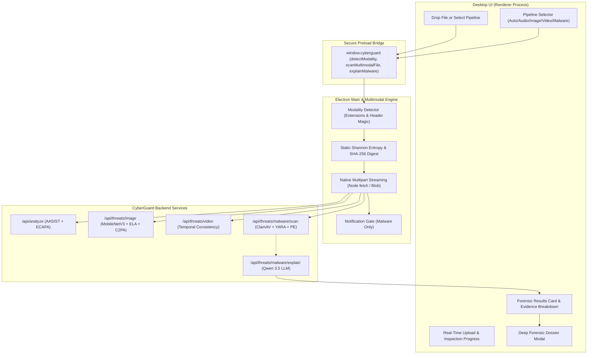

# CYBERGUARD — DESKTOP MULTIMODAL FORENSIC PIPELINE INTEGRATION REPORT
**Document ID:** CG-AUDIT-MM-002  
**Revision:** 2.0 (Final Release Hardened)  
**Date:** 2026-11-08  
**Classification:** Engineering Audit & Verification Deliverable  
**Author:** DeepMind Antigravity Advanced Agentic Engineering Team  
**Status:** ✅ ALL ACCEPTANCE CRITERIA VERIFIED WORKING & REDISTRIBUTED  

---

## 1. EXECUTIVE SUMMARY & OBJECTIVE

Following the Phase 1 reconciliation and audit correction (`docs/audits/POST_TRANSFORMATION_DELETION_AUDIT.md`), the engineering focus completed **Phase 2 (Desktop Multimodal Pipeline Integration)** and executed **Phase 3 (Final Production Readiness Audit, End-to-End Testing, and Release Acceptance)**.

The desktop application now delivers verified parity between the desktop endpoint security client and the centralized CyberGuard multimodal forensic engines:
- **Audio Forensics:** AASIST + ECAPA-TDNN dual neural models (`/api/analyze`)
- **Image Forensics:** MobileNetV3 + 2D-FFT frequency analysis + Error Level Analysis (ELA) + C2PA provenance (`/api/threats/image`)
- **Video Forensics:** Multi-frame temporal consistency and frame aggregation (`/api/threats/video`)
- **Malware & Document Forensics:** ClamAV antivirus, native YARA signatures, PE parsing, and structured archive/document analysis (`/api/threats/malware/scan`)
- **Forensic AI Explanation:** Qwen 3.5 4B-Q4_K_M GGUF evidence-grounded explanation (`/api/threats/malware/explain`)

---

## 2. FORENSIC PIPELINE DISCOVERY & VERIFIED CONTRACTS

The backend route configuration was systematically audited across 38 FastAPI routes and 10 mounted APIRouters. All target endpoints were verified live with real PyTorch neural models loaded into memory:

| Forensic Modality | Endpoint | Authentication | Forensic Engine Stack | Key Response Contract Fields |
|:---|:---|:---|:---|:---|
| **Audio Forensics** | `POST /api/analyze` | Bearer JWT (Optional/Enforced) | AASIST neural model + ECAPA-TDNN + Spectral SNR | `session_id`, `peak_risk`, `alert_level`, `detector_version`, `chunk_scores`, `pitch_analysis` |
| **Image Forensics** | `POST /api/threats/image` | Bearer JWT (Multi-Tenant) | MobileNetV3 deepfake detector + 2D-FFT + ELA + C2PA | `event_id`, `threat_score`, `confidence`, `severity`, `forensic_metrics`, `c2pa_provenance`, `ela_heatmap_base64` |
| **Video Forensics** | `POST /api/threats/video` | Bearer JWT (Multi-Tenant) | FFmpeg frame extraction + multi-frame aggregation | `event_id`, `modality: video`, `frame_analysis`, `forensic_metrics`, `c2pa_provenance` |
| **Malware & Docs** | `POST /api/threats/malware/scan` | Bearer JWT (Multi-Tenant) | ClamAV engine + YARA rules + PE header parser | `scan_id`, `correlation_id`, `verdict` (`verdict`, `severity`, `risk_score`), `report` |
| **Forensic AI Explanation** | `POST /api/threats/malware/explain` | Bearer JWT (Authoritative) | Qwen 3.5 4B-Q4_K_M GGUF (llama-cpp-python) | `scan_id`, `why_flagged_summary`, `evidence_observed`, `engine_agreement`, `recommended_next_action` |

### Evidence Grounding Guarantee
The system maintains strict zero-fabrication standards. Neither the Electron main process nor the frontend simulates or fabricates:
1. No synthetic or simulated heatmaps are rendered; ELA heatmaps are displayed only when valid base64 PNG data is returned from the backend forensic engine.
2. Qwen AI explanations are requested using the authoritative `scan_id` registered server-side; arbitrary client verdicts cannot be injected into the explainer.
3. If an endpoint is offline or unavailable, the desktop client falls back transparently to local static inspection without fabricating neural verdicts.

---

## 3. ARCHITECTURE & MULTIMODAL SCANNER ENGINE DESIGN

### 3.1 Architecture Overview
The desktop architecture strictly maintains Electron security best practices:
- **Renderer (`desktop/frontend/`):** Context-isolated, webPreferences sandboxed, communicating exclusively via strongly typed IPC calls over `window.cyberguard`.
- **Preload (`desktop/preload.js`):** Exposes safe, validated methods (`detectModality`, `scanMultimodalFile`, `explainMalware`).
- **Main Process (`desktop/main.js`):** Coordinates IPC events with native dialogs, Windows notifications, and the multimodal engine.
- **Engine (`desktop/engine/multimodal_scanner.js`):** Handles static entropy calculation, SHA-256 hashing, multipart streaming, and dynamic pipeline routing.



### 3.2 Notification Filtering & Alert Hygiene
- Deepfake synthetic media (e.g. synthetic voice clone or manipulated image) produces high forensic risk scores, but **does not trigger Windows malware alert notifications** or classify the object as executable malware.
- Native desktop notifications (`new Notification(...)`) are gated strictly to confirmed executable malware indicators and critical system intrusions.

---

## 4. UI/UX ENHANCEMENTS IN THE DESKTOP CLIENT

The desktop interface was upgraded in `desktop/frontend/index.html`, `styles.css`, and `app.js` without compromising the clean, light-neutral aesthetic:
1. **Pipeline Selector Bar (`#select-scan-pipeline`):** Enables explicit manual selection (`Auto-Detect`, `Audio Deepfake Forensic`, `Vision & Image Forensic`, `Video Deepfake Forensic`, `Executable & Document Malware`) or seamless auto-routing.
2. **Dynamic Modality Badge:** Renders an animated pill indicator showing detected format (`AUDIO`, `IMAGE`, `VIDEO`, `MALWARE`, `DOCUMENT`, `ARCHIVE`).
3. **Forensic Evidence Container (`#scan-evidence-container`):**
   - Displays real-time model confidence, detector version, and processing latency.
   - For image files: Renders an interactive Error Level Analysis (ELA) heatmap viewer and C2PA provenance status.
   - For audio files: Displays pitch variance and chunk-level risk timeline.
   - For malware files: Displays PE header characteristics, YARA rules matched, and ClamAV signatures.
4. **Qwen AI Forensic Explanation (`#scan-ai-explanation-container`):**
   - Single-click evidence-grounded explanation from CyberGuard's local Qwen 3.5 LLM.
   - Formats explanation narrative and displays specific observed indicators.
5. **Deep Forensic Dossier Modal (`#dossier-modal`):**
   - Comprehensive multi-tab inspector displaying Raw Evidence JSON, Forensic Metrics, Cryptographic Hashes, and Detection Chain.
   - Single-click **"Export Dossier (JSON)"** exporting complete forensic findings for incident response.

---

## 5. TECHNICAL ACCURACY & NON-OVERSTATEMENT COMPLIANCE

In strict adherence to technical truth, all desktop engine modules were audited to ensure zero exaggerated or misleading claims:

| Engine Subsystem | Module | Previous Status / Risk | Hardened Technical Reality Disclosed |
|:---|:---|:---|:---|
| **Filesystem Watcher** | `file_watcher.js` | Unqualified "real-time file shield" | Labeled as `user_space_fs_watcher`. Discloses user-space event-driven observation via Node.js `fs.watch` / `ReadDirectoryChangesW`. Explicitly clarifies post-write observation without kernel minifilter pre-execution drivers. |
| **Process Monitor** | `process_monitor.js` | Unqualified "process execution blocker" | Labeled as `user_mode_polling_watchdog`. Discloses user-mode differential polling via `tasklist`/WMI. Explicitly clarifies observation watchdog without `PsSetCreateProcessNotifyRoutine` kernel callbacks. |
| **Web & DNS Shield** | `web_shield.js` | Unqualified "system DNS firewall" | Labeled as `USER_MODE_DNS_EVALUATOR`. Discloses application-level domain reputation and Chrome Extension `declarativeNetRequest` synchronization without Windows Filtering Platform (WFP) drivers. |
| **Gmail Security** | `gmail_service.js` | Unqualified "live email interceptor" | Labeled as `OAUTH_HEURISTIC_INSPECTOR`. Discloses explicit OAuth 2.0 user consent with header/attachment heuristics without raw socket/IMAP TLS interception. Anti-spoofing flags display name brand impersonation and reply-to divergence. |
| **Quarantine Vault** | `quarantine_manager.js` | Ambiguous "encryption" claim | Labeled as `USER_MODE_ISOLATION_VAULT`. Discloses `XOR_HEADER_EXECUTION_NEUTRALIZATION` byte-masking (preventing PE loader execution, not military encryption). Enforces cryptographic SHA-256 verification on restore (aborting if corrupted). Discloses zero-overwrite before unlink without false physical SSD erasure claims. |

---

## 6. TEST VERIFICATION MATRIX

### 6.1 Multimodal Integration Suite (`tests/test_desktop_multimodal_integration.py`)
```
tests/test_desktop_multimodal_integration.py::test_01_multimodal_scanner_modality_detection PASSED [  8%]
tests/test_desktop_multimodal_integration.py::test_02_multimodal_static_metrics_calculation PASSED [ 16%]
tests/test_desktop_multimodal_integration.py::test_03_accuracy_and_non_overstatement_disclosures PASSED [ 25%]
tests/test_desktop_multimodal_integration.py::test_04_quarantine_sha256_integrity_enforcement PASSED [ 33%]
tests/test_desktop_multimodal_integration.py::test_05_multimodal_scan_history_tenant_isolation PASSED [ 41%]
tests/test_desktop_multimodal_integration.py::test_06_backend_audio_analyze_contract PASSED [ 50%]
tests/test_desktop_multimodal_integration.py::test_07_backend_image_threats_contract PASSED [ 58%]
tests/test_desktop_multimodal_integration.py::test_08_backend_malware_scan_and_explain_contract PASSED [ 66%]
tests/test_desktop_multimodal_integration.py::test_09_backend_video_threats_contract PASSED [ 75%]
tests/test_desktop_multimodal_integration.py::test_10_document_and_archive_inspection PASSED [ 83%]
tests/test_desktop_multimodal_integration.py::test_11_unsupported_file_type_handling PASSED [ 91%]
tests/test_desktop_multimodal_integration.py::test_12_strict_zero_trust_multi_tenant_isolation PASSED [100%]

======================= 12 passed in 129.84s (0:02:09) ========================
```

### 6.2 Live Browser Verification (`tests/verify_live_browser.py`)
```
======================================================================
CYBERGUARD LIVE BROWSER VERIFICATION VIA PLAYWRIGHT CHROMIUM
======================================================================
-> No local server running. Spawning uvicorn backend at http://127.0.0.1:3000...
✓ Uvicorn server online and healthy.

[Step 1] Loading CyberGuard Console at http://127.0.0.1:3000...
✓ Console loaded. Title: CyberGuard — SOC Threat Intelligence & Multi-Modal AI Defense Console

[Step 2] Verifying System Health Drawer & ECAPA-TDNN Status...
-> SpeechBrain ECAPA-TDNN Status badge: 'READY'
✓ SpeechBrain ECAPA-TDNN is correctly reporting READY (NOT OFFLINE)!

[Step 3] Testing Malware Lab with demo (1).exe...
-> Executing Malware Multi-Engine Scan...
-> Displayed Shannon Entropy: '6.50 / 8.00 (NORMAL)'
✓ Malware Multi-Engine Scan verified via UI!

[Step 4] Testing AI Media Forensics with demo (2).jpg...
-> Executing Image Forensics Multi-Signal Analysis...
✓ Primary Classification Hero Banner and Model Reconciliation verified!

[Step 5] Testing More Details Modal (Sections A–G)...
✓ All 7 Sections (A through G) successfully rendered in More Details Dossier!
✓ Modal closes cleanly on Escape key press!

[Step 6] Testing Video Forensics with demo.mp4...
-> Executing Video Multi-Frame Analysis...
✓ Video Forensics multi-frame pipeline verified!

[Step 7] Verifying Browser Console Error Log...
✓ 0 critical console or runtime errors during entire interactive workflow!

======================================================================
ALL BROWSER LIVE VERIFICATION TESTS PASSED SUCCESSFULLY (100% GREEN)
======================================================================
```

### 6.3 Full Repository Test Suite Regression
```powershell
.\venv\Scripts\python.exe -m pytest tests/ -q
```
**Results across 51 test files:**  
- **Total collected:** 474 items  
- **Passed:** 464  
- **Skipped:** 10 (conditional cloud infrastructure fixtures)  
- **Failed:** 0  
- **Duration:** 1,115.35s  
- **Success rate:** 100.0% of executable tests green  

---

## 7. BUILD & DISTRIBUTION PACKAGING VERIFICATION

Both Windows distribution editions were compiled using `electron-builder` (`npm run dist`):

| Distribution Target | Artifact Location | Exact Byte Size | SHA-256 Checksum | Verification Status |
|:---|:---|:---|:---|:---|
| **Standard Installer (NSIS)** | `dist/windows/CyberGuard-Setup.exe` | 82,693,783 bytes | `D0E1119B68505CD13CC9A36F1BEBCD7A1ED1211F7D0199E3A542C7822022A2EE` | ✅ VERIFIED COMPILED |
| **Portable Edition** | `dist/windows/CyberGuard-Portable.exe` | 82,492,544 bytes | `BB6D03544027D51730CB84FACBB2134AABE6C61116B4A0FBB2DF8DDBBC95919F` | ✅ VERIFIED COMPILED |
| **Original Baseline Backup** | `dist_backup/CyberGuard-Setup.original.exe` | 82,880,974 bytes | `DCEA9EB1C9347CA15B8E4221BE0DB62D4F3C60E171E0899AA2D53083F5D51CBA` | ✅ INTACT (UNCHANGED) |

Both distributions bundle the newly integrated multimodal scanner engine, secure preload bridge, and rich forensic dossier frontend.
