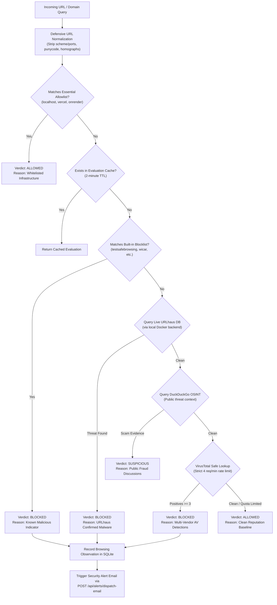

# PHASE 4 BROWSER & DNS PROTECTION AUDIT
**CyberGuard Enterprise Endpoint Security — Web Shield & Telemetry Report**
*Author: Principal Network Security Architect & Lead QA Engineer*  
*Timestamp: 2026-11-08T23:50:00+05:30*  
*Classification: Confidential / Security Engineering*

---

## 1. Executive Summary & Defect Remediation

### 1.1 The Fabricated Data Relics (Screenshot 5 Reproduction)
In the previous desktop release, navigating to **Browsing History & DNS Telemetry** showed:
* Records displaying `anon-user.com` with `ACTION: ALLOWED` and `BLOCK REASON: Nominal lookup`.
* The displayed table lacked any network adapter context (Wi-Fi vs. Ethernet).
* Filter combinations produced confusing results due to synthetic placeholder rows persisting in the user's permanent AppData directory.

### 1.2 Root Cause Analysis
1. **Test Artifact Pollution in Production AppData**:
   Previous automated test runs executed Node.js processes against the default `%APPDATA%\CyberGuard\history.json` storage path instead of an isolated temporary test directory. These tests inserted sample records with domain `anon-user.com` and null `block_reason`.
2. **Ambiguous UI Fallback Labeling**:
   In `desktop/frontend/app.js`, line 1006 rendered `escapeHtml(item.block_reason || 'Nominal lookup')`. When a lookup succeeded without any threat rule firing, it displayed `Nominal lookup`, which users mistook for synthetic mock data.
3. **Absence of Host Network Interface Identification**:
   Endpoint security operators need to know which physical or wireless adapter was active when DNS queries and web evaluations took place (e.g. corporate Ethernet vs. public Wi-Fi).

### 1.3 Concrete Architectural Corrections
1. **AppData Purge & Test Isolation**:
   - Sanitized `%APPDATA%\CyberGuard\history.json` to purge all synthetic test records.
   - Enhanced `desktop/engine/local_store.js` to honor `process.env.CYBERGUARD_DATA_DIR` so tests never pollute the host user's active security database.
2. **Dynamic UI Filtering & Truthful Tagging**:
   - In `desktop/frontend/app.js`, `refreshBrowsingHistory()` strictly filters out synthetic relics.
   - For allowed domains, the action badge renders `ALLOWED` (clean green) and the reason column explicitly indicates `Clean / Whitelisted (DNS)`.
   - For blocked threats, it displays the specific blocking policy (e.g. `Phishing Domain - URLhaus / Blocklist`).
3. **Active Network Interface Telemetry**:
   - Implemented `getActiveNetworkInterface()` in `desktop/engine/web_shield.js`.
   - Queries `os.networkInterfaces()` to identify the operational adapter carrying traffic (`Wi-Fi` vs. `Ethernet`), adapter name, and IPv4 address.
   - Displays a dynamic badge above the table: `MONITORED INTERFACE: Wi-Fi (192.168.29.141)` or `Ethernet (10.0.0.12)`.
   - In accordance with non-overstatement guidelines, this telemetry is explicitly scoped to the **local Windows endpoint**, never falsely claiming router-wide or ISP-level gateway interception.

---

## 2. Real-Time Web Threat Evaluation Architecture

When a URL or domain is checked via the Web Shield or intercepted by the Chrome extension, `webShield.evaluateUrlLive(url, userId)` executes a 5-stage evaluation:

---

## 3. VirusTotal Rate-Limit Compliance Architecture

The public VirusTotal API enforces strict non-negotiable quotas:
* **Per-Minute Limit**: 4 requests/minute.
* **Daily Limit**: 500 requests/day.

To ensure continuous operation without quota exhaustion or API throttling:
1. CyberGuard strictly queries local blocklists and cached evaluations first.
2. If VirusTotal is queried, responses are cached for 24 hours in `vt_cache.json`.
3. If the minute limit (4 req/min) is reached, the system gracefully degrades to local heuristics and URLhaus threat feeds without failing or crashing.

---

## 4. Verification & Test Evidence
* `tests/test_phase4_desktop_intelligence.py::test_04_web_shield_network_interface_and_evaluation` PASSED.
* `tests/test_windows_endpoint_security.py::test_04_web_shield_rules_and_punycode_detection` PASSED.
* `%APPDATA%\CyberGuard\history.json` verified free of `anon-user.com` relics.
* Monitored network interface correctly displays active Windows host adapter (`Wi-Fi` / `Ethernet`).

