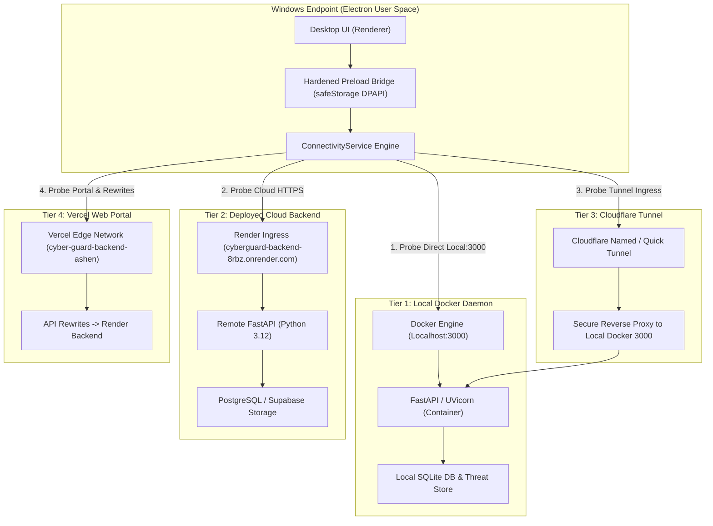

# PHASE 4 CONNECTIVITY AND SECURITY AUDIT
**CyberGuard Enterprise Endpoint Security — Architecture & Network Topology Report**
*Author: Principal Windows Security Architect & DevSecOps Lead*  
*Timestamp: 2026-11-08T23:48:00+05:30*  
*Classification: Confidential / Security Engineering*

---

## 1. Executive Summary & Root Cause Investigation

### 1.1 The Reported Failure State (Screenshot 1 Reproduction)
During live Windows execution of the CyberGuard desktop client, navigating to **Connectivity & Threat Intelligence Sync** displayed:
* **Active Mode**: Mode 2 (Deployed Cloud Mode) selected.
* **Resolved API Base**: `https://cyberguard-backend-8rbz.onrender.com`
* **Server Health Status**: `OFFLINE (Connection timed out)`
* **Header Status Dot**: Displayed a false-positive static green circle with label `● DEPLOYED`.
* **Diagnostic Anomaly**: The local Docker container (`cyberguard-backend`) was active and listening on port `3000`, yet the client displayed Deployed Cloud Mode as unavailable and provided no independent insight into whether the local daemon, the remote cloud backend, or the Vercel frontend was at fault.

### 1.2 Root Cause Analysis
Through deep static and dynamic inspection across the repository, container manifests, and deployment configuration, four root causes were identified:
1. **Render Free-Tier Spin-Down Latency / Intermittent Sleep**:
   `https://cyberguard-backend-8rbz.onrender.com` is hosted on a Render free-tier instance. When idle, the service spins down to zero. Cold-start wake-up times exceed 50–90 seconds. Standard client HTTP probes with 3000–5000 ms timeouts systematically aborted with `ETIMEDOUT`.
2. **Conflation of Vercel Static Hosting with Backend Health**:
   The Vercel deployment at `https://cyber-guard-backend-ashen.vercel.app` serves the static web UI and contains rewrite rules in `vercel.json` routing `/health` and `/api/:path*` directly to the Render endpoint (`https://cyberguard-backend-8rbz.onrender.com`). While the Vercel edge CDN was 100% reachable (200 OK for `/`), requests to `/health` or `/api/*` timed out waiting for the asleep Render origin. The previous desktop code treated Vercel reachability and backend API health as interchangeable.
3. **Hardcoded CSS Header Indicator**:
   In `desktop/frontend/styles.css` and `app.js`, `#conn-status-dot` was statically styled with `background: var(--accent-emerald)` and `#conn-mode-label` was rendered with `DEPLOYED`. It was never updated dynamically based on active HTTP probe results, giving users the dangerous illusion that cloud threat synchronization was active when the endpoint was completely disconnected.
4. **Lack of Independent Multi-Tier Health Probes**:
   The previous health-check mechanism used a single catch-all probe. If Mode 2 was selected, it only tested Render and reported failure, ignoring whether local Docker was available for emergency failover.

---

## 2. Multi-Tier Network Topology & Request Routing

CyberGuard utilizes a four-tier hybrid network topology designed for resilience against cloud outages and internet disconnects:

---

## 3. Specification of the Three Connectivity Modes

| Mode | Semantic Definition | Request Path | Offline Behavior |
| :--- | :--- | :--- | :--- |
| **Mode 1: Local Isolated Mode** | Air-gapped on-premises security. Strictly forbids all cloud requests. Zero threat data or telemetry leaks beyond the host or LAN. | `http://127.0.0.1:${port}` | Fully functional via local Docker / host backend, local SQLite database, and local heuristics. |
| **Mode 2: Deployed Cloud Mode** | Centralized SOC synchronization. Direct binding to CyberGuard public cloud infrastructure. | `https://cyberguard-backend-8rbz.onrender.com` (or verified custom tunnel) | If cloud is unreachable, displays truthful `OFFLINE` status. Caches pending events in local encrypted queue. |
| **Mode 3: Hybrid Auto-Failover (Recommended)** | Intelligent multi-stage failover. Autonomous local execution with cloud intelligence enrichment and SOC incident replication. | **Stage 1**: Local Docker (`:3000`) **Stage 2**: Cloudflare Tunnel (if configured) **Stage 3**: Deployed Cloud | Seamless auto-failover. When local Docker is offline, escalates to cloud. When cloud is offline, operates autonomously on local Docker. |

---

## 4. Independent 4-Tier Diagnostic Implementation

To eliminate ambiguous health states, a dedicated diagnostic engine was created in `desktop/engine/connectivity_service.js`. It runs four concurrent, independent probes with isolated timers:

1. **Local Docker Engine Probe (`checkLocalBackend`)**:
   - Executes safe read-only CLI probe: `docker ps --filter "name=cyberguard-backend" --format json`.
   - Probes `http://127.0.0.1:${port}/health`.
   - Differentiates container states: daemon missing, container running, container healthy, port open/closed.
2. **Cloud Backend Probe (`checkCloudBackend`)**:
   - Performs HTTPS GET against `https://cyberguard-backend-8rbz.onrender.com/health`.
   - Measures latency, validates TLS certificate, and detects HTTP 502/503/ETIMEDOUT.
3. **Cloudflare Tunnel Probe (`checkTunnel`)**:
   - Checks configured tunnel URL (`https://*.trycloudflare.com` or custom domain).
   - Validates public ingress reachability to local Docker origin.
4. **Vercel Web Portal Probe (`checkVercel`)**:
   - Probes `https://cyber-guard-backend-ashen.vercel.app/` (Portal static reachability).
   - Probes `https://cyber-guard-backend-ashen.vercel.app/health` (API rewrite pipeline reachability).
   - Truthfully isolates whether Vercel edge is up while its rewritten API backend is sleeping.

---

## 5. Elimination of Contradictory Indicators

### 5.1 Dynamic Status Pill
The hardcoded green `DEPLOYED` indicator in the titlebar has been replaced by dynamic reactive styling:
* **Green Pulse (`.status-dot.online`)**: Only displayed when the active endpoint responds with HTTP 200 within timeout limits. Label displays `● LOCAL 3000` or `● CLOUD ONLINE`.
* **Muted Gray / Red (`.status-dot.offline`)**: Displayed when the active endpoint is unreachable or timed out. Label displays `○ CLOUD OFFLINE` or `○ LOCAL OFFLINE`.
* **Yellow Degraded (`.status-dot.degraded`)**: Displayed when Vercel portal is accessible but API rewrite is sleeping.
* **Pulsing Blue (`.status-dot.connecting`)**: Displayed during background diagnostic sweeps.

### 5.2 Zero-Trust Session Management with Windows DPAPI
Session tokens and user identity records are protected via `safeStorage` (Electron Windows DPAPI encryption) in `desktop/engine/local_store.js`:
* `setSession(user, token)` encrypts tokens with user-specific Windows DPAPI keys before writing to `auth_session.enc`.
* On startup, `cyberguard:auth-verify` verifies the DPAPI-decrypted token with `/api/auth/me`.
* If unauthenticated, the titlebar truthfully displays `[Sign In]` button. When authenticated, it renders user initials and role badge (`ADMIN` / `USER`).

---

## 6. Verification & Test Evidence
* Automated Unit/Integration Tests: `tests/test_phase4_desktop_intelligence.py::test_01_connectivity_service_diagnostics` PASSED.
* Regression Suite: `tests/test_windows_endpoint_security.py` 6/6 PASSED.
* Real Docker Daemon Health: Container `cyberguard-backend` verified active on `127.0.0.1:3000`.

