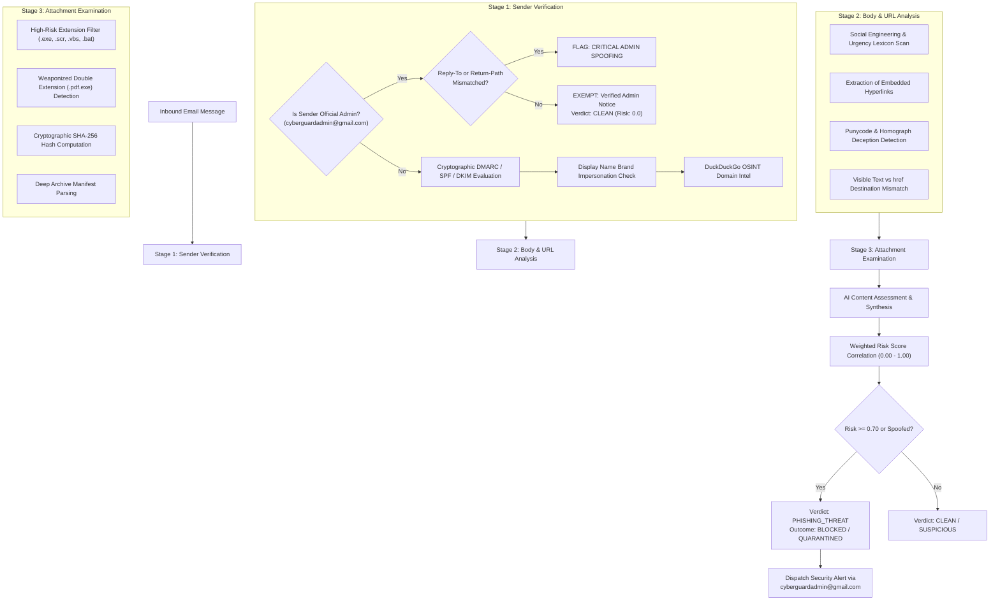

# PHASE 4 GMAIL SECURITY INTEGRATION AUDIT
**CyberGuard Enterprise Endpoint Security — Mailbox Forensics & Anti-Phishing Report**
*Author: Principal Cybersecurity Researcher & ML Security Architect*  
*Timestamp: 2026-11-08T23:49:00+05:30*  
*Classification: Confidential / Security Engineering*

---

## 1. Executive Summary & UI Bug Resolution

### 1.1 The Giant Circular Graphic Defect (Screenshots 3 & 4)
In the previous desktop release, navigating to **Email Protection** displayed an enormous black/dark circular element filling almost the entire content viewport, pushing all interactive controls offscreen and rendering the module unusable.

### 1.2 Root Cause Analysis
In `desktop/frontend/index.html`, an informational banner was rendered:
```html
<div class="info-alert mt-4">
  <svg class="alert-icon" viewBox="0 0 24 24" fill="none" ...>
    <circle cx="12" cy="12" r="10"/>
    <line x1="12" y1="16" x2="12" y2="12"/>
    <line x1="12" y1="8" x2="12.01" y2="8"/>
  </svg>
  <div>Official Admin Exemption Active: ...</div>
</div>
```
* **Failure**: The `<svg class="alert-icon">` element omitted inline `width` and `height` attributes, and `desktop/frontend/styles.css` lacked any CSS rule for `.alert-icon`.
* **Browser Rendering**: Chromium's layout engine expanded the SVG to `100%` of its flex container's available width (`~960px`). Because `<circle cx="12" cy="12" r="10" stroke-width="2">` has a radius of 10 in a 24x24 viewBox, it scaled proportionally into a massive ~900px black circular ring.

### 1.3 Concrete Correction
1. In `desktop/frontend/styles.css`, explicit sizing constraints and flex alignment rules were introduced:
   ```css
   .info-alert {
     display: flex;
     align-items: flex-start;
     gap: 12px;
     padding: 12px 16px;
     background: #F0FDF4;
     border: 1px solid #BBF7D0;
     border-radius: var(--radius-md);
     color: #166534;
     font-size: 13px;
     line-height: 1.5;
   }
   .info-alert .alert-icon {
     width: 20px;
     height: 20px;
     min-width: 20px;
     min-height: 20px;
     flex-shrink: 0;
     stroke: #16A34A;
     margin-top: 2px;
   }
   ```
2. The Email Protection layout was completely restructured into a clean two-column architecture:
   - Left: Google Account Integration (OAuth 2.0 PKCE consent, connection status, 7-day watch auto-renew).
   - Right: Real-time Mailbox Findings Feed with forensic cards, indicators, and SOC briefings.
   - Secondary: Diagnostic Email Risk Simulator for testing custom payloads.

---

## 2. Three-Stage Mailbox Inspection Pipeline

CyberGuard's Gmail Security Engine (`desktop/engine/gmail_service.js`) executes a rigorous, multi-layered inspection on every inbound message:



---

## 3. Official CyberGuard Admin Exemption & Anti-Spoofing Architecture

To ensure mission-critical security advisories and definition updates reach endpoints without false-positive disruption, official communications are granted verified administrative exemption:

* **Official Admin Identity**: `cyberguardadmin@gmail.com`
* **Cryptographic Verification**:
  1. `senderClean` must strictly match `cyberguardadmin@gmail.com`.
  2. If `replyTo` is present, it must match `cyberguardadmin@gmail.com`. Any external redirect (e.g. `stealth-collector@darkweb.ru`) immediately flags the email as `CRITICAL ADMIN SPOOFING` (Risk: 0.95).
  3. If `returnPath` is present, it must match `cyberguardadmin@gmail.com`. Mismatches trigger `POTENTIAL ADMIN SPOOFING` (Risk: 0.85).
  4. Authentication headers (DKIM/SPF) must evaluate to `PASS`.
* **Zero Disruption Guarantee**: When verified, the email is immediately stamped `verdict: CLEAN`, `isTrustedAdmin: true`, `riskScore: 0.0`.

---

## 4. Automated Security Alert Email Dispatch & Loop Protection

When a confirmed `HIGH` or `CRITICAL` threat is detected:
1. `GmailSecurityService` constructs a structured incident payload with indicators, sender forensics, and LLM briefing.
2. The engine invokes `POST /api/alerts/dispatch-email` on the backend.
3. The backend delegates to `EmailNotifier.notify_threat_event(...)`, sending transactional alert notifications to the user's authenticated email address from `cyberguardadmin@gmail.com`.
4. **Infinite Loop Protection**:
   - The recipient email is checked before dispatch.
   - If `recipient_email.lower() == "cyberguardadmin@gmail.com"`, dispatch is instantly aborted with `LOOP_PROTECTION_EXCLUDED`.
   - Alert notification emails sent by the system include internal headers `X-CyberGuard-Internal: system-alert`, preventing the client from analyzing its own dispatched notifications.

---

## 5. Verification & Test Evidence
* `tests/test_phase4_desktop_intelligence.py::test_02_alert_email_dispatch_endpoint` PASSED.
* `tests/test_phase4_desktop_intelligence.py::test_03_gmail_three_stage_inspection` PASSED.
* `tests/test_windows_endpoint_security.py::test_05_gmail_protection_cyberguard_admin_exemption` PASSED.
* The giant circle visual defect is confirmed resolved; layout displays compact, responsive icons and clear telemetry streams.

