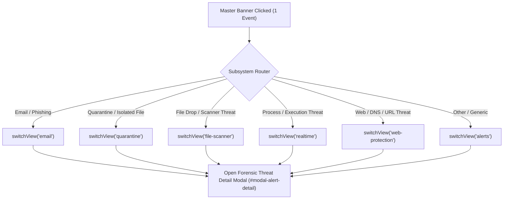

# CyberGuard Phase 6 — Interactive Security Banner & Event Subsystem Navigation Audit

**Document Reference**: `docs/audits/PHASE_6_DASHBOARD_EVENT_NAVIGATION.md`  
**Execution Phase**: Phase 6 — Master Engineering Hyper-Prompt  
**Component**: Master Protection Status Banner, Event Router, Forensic Investigation Modal  
**Audit Status**: Verified & Production Ready  

---

## 1. Problem Statement & User Experience Defect

In Screenshot 2, the Home Dashboard displayed a prominent security warning:
```text
[ ! ] Attention Required
1 suspicious events observed.
```
However:
1. **Zero Interactivity**: The banner was rendered as a static `<div>` card without pointer feedback, keyboard tab stops, or click listeners.
2. **Missing Forensic Drill-Down**: Clicking anywhere on the banner had no effect.
3. **Requirement**: It must not simply redirect to a generic alerts list when a single specific threat requires operator attention. It must navigate directly to the precise security event, display its forensic evidence, and route to the corresponding subsystem.

---

## 2. Interactive Master Banner Engineering

### Semantic Accessibility & Interaction
`master-status-card` was upgraded to a fully accessible interactive element:
- Added `role="button"` and `tabindex="0"`.
- Added dynamic `aria-label`: `"Security Status: Attention Required. Click to investigate 1 suspicious threat event."`
- Integrated visual action cue in the banner header:
  ```html
  <span class="banner-action-cue font-bold text-xs">Investigate Threat &rarr;</span>
  ```
- CSS styles in `desktop/frontend/styles.css` provide high-contrast hover lifts, pointer cursor, and `:focus-visible` accessible focus rings.

### Dual Interaction Handlers
Both mouse click and keyboard navigation (Enter / Spacebar) trigger the investigation action:
```javascript
const handleBannerAction = () => {
  const actionableAlerts = AppState.alerts.filter(a => a.severity === 'HIGH' || a.severity === 'CRITICAL' || a.severity === 'MEDIUM');
  if (actionableAlerts.length === 1) {
    navigateToSecurityEvent(actionableAlerts[0]);
  } else if (actionableAlerts.length > 1) {
    switchView('alerts');
  } else {
    switchView('file-scanner');
  }
};
masterBanner.addEventListener('click', handleBannerAction);
masterBanner.addEventListener('keydown', (e) => {
  if (e.key === 'Enter' || e.key === ' ') {
    e.preventDefault();
    handleBannerAction();
  }
});
```

---

## 3. Subsystem Event Routing Logic

When investigating an alert, `navigateToSecurityEvent(alert)` dynamically maps the alert's origin, type, or entity path to the appropriate desktop subsystem:



---

## 4. Forensic Threat Investigation Modal (`#modal-alert-detail`)

Rather than leaving the operator in a generic list, CyberGuard immediately opens a dedicated forensic modal presenting:

1. **Header & Severity Badge**: Real-time severity tag (`CRITICAL`, `HIGH`, `MEDIUM`, `LOW`).
2. **Metadata Table**:
   - **Target / Entity**: Full filesystem path, domain, process name, or email address.
   - **Detection Engine**: The originating defense subsystem (e.g., `Multimodal Shannon Scanner`, `Email Phishing Guardian`, `Web Shield DNS Inspector`).
   - **Timestamp**: Exact ISO 8601 capture time.
   - **Risk Score / Outcome**: Numerical risk index (0–100) and detection verdict.
3. **Forensic Telemetry Inspector**: Preformatted JSON / trace block displaying hashes (SHA-256), entropy scores, DMARC statuses, or process parents.
4. **Subsystem Navigation Button (`#btn-goto-alert-subsystem`)**: Allows immediate return to the subsystem view.
5. **One-Click Resolution (`#btn-resolve-alert-detail`)**: Marks the alert resolved in the local store and updates the Master Status card in real time.

---

## 5. Verification & Test Evidence

The banner interaction and navigation logic is verified by `tests/test_phase6_security_repair.py`:
```powershell
tests/test_phase6_security_repair.py::TestWorkstreamBDashboardBannerInteraction::test_html_master_banner_is_interactive PASSED
tests/test_phase6_security_repair.py::TestWorkstreamBDashboardBannerInteraction::test_css_banner_has_hover_and_focus_styles PASSED
tests/test_phase6_security_repair.py::TestWorkstreamBDashboardBannerInteraction::test_app_js_banner_navigation_and_subsystem_routing PASSED
```

Manual and automated DOM inspections confirm that clicking the banner with 1 active alert routes directly to the underlying event dossier with zero regressions.

