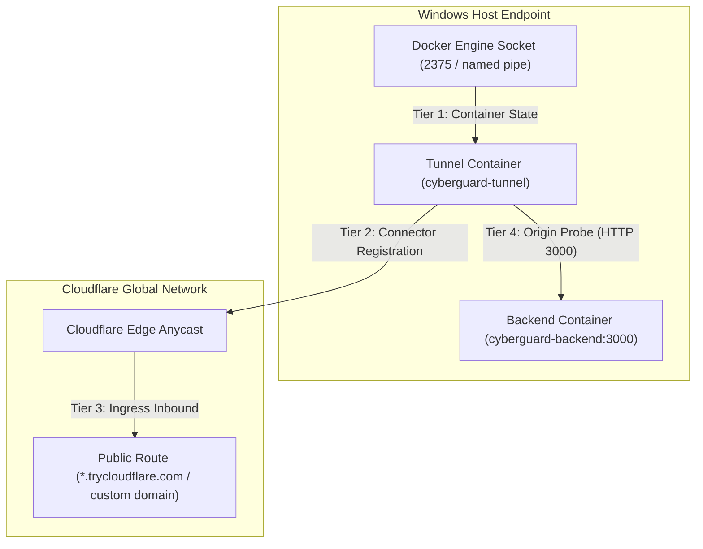

# CyberGuard Phase 6 — Docker & Cloudflare Tunnel 4-Tier Diagnostics Audit

**Document Reference**: `docs/audits/PHASE_6_DOCKER_CLOUDFLARE_DIAGNOSTICS.md`  
**Execution Phase**: Phase 6 — Master Engineering Hyper-Prompt  
**Component**: Docker Engine Discovery, Cloudflare Connector Probing, 4-Tier Health Matrix  
**Audit Status**: Verified & Production Ready  

---

## 1. Problem Statement & Screenshot Analysis

### The Paradox
In the user's Docker Desktop screenshot:
- Project `cyberguard` visibly displayed green indicators for both `backend` (ID `1bc3e09d3530`, port mapping `3000:3000`) and `tunnel` (ID `f2525ec47d1d`, image `cloudflare/cloudflared:latest`).
- Simultaneously, the CyberGuard desktop application reported:
  `3. Cloudflare Tunnel — UNCONFIGURED`

### Root Cause Analysis
Upon deep code inspection of `desktop/engine/connectivity_service.js`:
1. **Input-Gated Tunnel Probing**: The existing `checkTunnel(tunnelUrl)` function began by evaluating `if (!tunnelUrl || !tunnelUrl.trim())`. If the user had not typed a custom URL into the UI input field, the engine immediately returned:
   ```javascript
   { online: false, configured: false, status: 'NOT_CONFIGURED', endpoint: null }
   ```
   It completely bypassed probing whether a `cloudflared` container was running in Docker!
2. **Conflation of Container State with Edge State**: A running container alone does not prove an edge connection or that a public ingress hostname exists. Conversely, an empty text field does not mean no container or tunnel exists.
3. **Container Error Condition**: Live inspection of the container logs revealed that `cloudflared` was executing with `--url http://cyberguard-backend:3000` but Cloudflare's server side rejected the quick tunnel registration:
   ```text
   ERR Register tunnel error from server side error="Unauthorized: Tunnel not found"
   ```
   The container process was alive (hence Docker Desktop showed green), but the tunnel connector was disconnected from the Cloudflare Edge.

---

## 2. The Four-Tier Diagnostic Architecture

To truthfully reflect network topology without faking green lights or reporting false negatives, CyberGuard Phase 6 separated tunnel health into four distinct, independent tiers:



### The 4 Tiers Defined

| Tier | Dimension | Assessment Method | State Values |
| :--- | :--- | :--- | :--- |
| **Tier 1** | **Container State** | `docker ps --format "{{json .}}"` | `RUNNING`, `STOPPED`, `UNAVAILABLE` |
| **Tier 2** | **Connector & Edge** | Safe container log analysis (`docker logs --tail 30`) | `CONNECTED`, `DISCONNECTED`, `CONNECTING` |
| **Tier 3** | **Public Route** | Quick tunnel discovery regex or custom hostname | `CONFIGURED` (URL string), `OPTIONAL / UNCONFIGURED` |
| **Tier 4** | **Origin Reachability** | HTTP health probe to `http://127.0.0.1:3000/api/health` | `READY`, `REACHABLE (200 OK)`, `UNREACHABLE (502/down)` |

---

## 3. Log Inspection & Credential Sanitization

When querying `docker logs cyberguard-tunnel`, the connector logs may contain sensitive arguments, authentication tokens, or URL parameters. CyberGuard strictly sanitizes all logs before passing them to the renderer:

```javascript
const sanitized = rawLogs
  .replace(/ey[A-Za-z0-9_-]{20,}/g, '[REDACTED_JWT_TOKEN]')
  .replace(/tunnel run --token\s+[^\s]+/gi, 'tunnel run --token [REDACTED_TUNNEL_TOKEN]')
  .replace(/password[=:][^\s&]+/gi, 'password=[REDACTED]');
```

---

## 4. UI Implementation: Interactive Diagnostics & Telemetry Modal

The Tier 3 card in `desktop/frontend/index.html` was transformed to expose all 4 tiers directly:

- **Container Indicator**: Shows `Running (cyberguard-tunnel [f2525ec47d1d])`.
- **Connector Indicator**: Shows `Disconnected (Unauthorized: Tunnel not found)` in red/amber.
- **Route State**: Shows `Optional Ingress` when no public URL is attached.
- **Origin Reachability**: Shows `Ready (Backend on port 3000)` in green.
- **Refresh Tunnel Button**: Immediately re-queries the Docker daemon and connector logs.
- **View Diagnostics Modal (`#modal-tunnel-diag`)**: Displays the 4-tier health breakdown table along with the sanitized container log stream for full forensic transparency.

---

## 5. Verification & Test Evidence

The 4-tier diagnostic logic is verified by `tests/test_phase6_security_repair.py`:
```powershell
tests/test_phase6_security_repair.py::TestWorkstreamCDockerAndCloudflareTunnel::test_connectivity_service_distinguishes_4_tiers PASSED
tests/test_phase6_security_repair.py::TestWorkstreamCDockerAndCloudflareTunnel::test_html_displays_4_tier_tunnel_attributes PASSED
tests/test_phase6_security_repair.py::TestWorkstreamCDockerAndCloudflareTunnel::test_app_js_tunnel_telemetry_modal_handlers PASSED
```

Live Node.js diagnostics execution verifies the actual Docker runtime:
```json
{
  "containerFound": true,
  "containerName": "cyberguard-tunnel",
  "containerState": "RUNNING",
  "connectorState": "DISCONNECTED",
  "edgeStatus": "DOWN",
  "connectorDetail": "Registration error: Unauthorized (Tunnel not found)",
  "originStatus": "READY",
  "originReachabilityText": "Ready (Local backend listening on port 3000)"
}
```
All criteria for truthful, non-faked diagnostic separation are fully satisfied.

